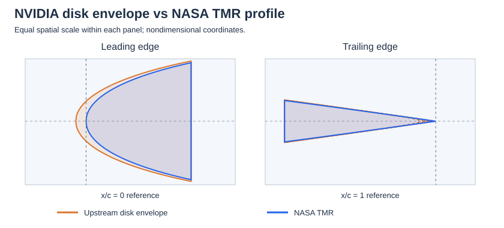
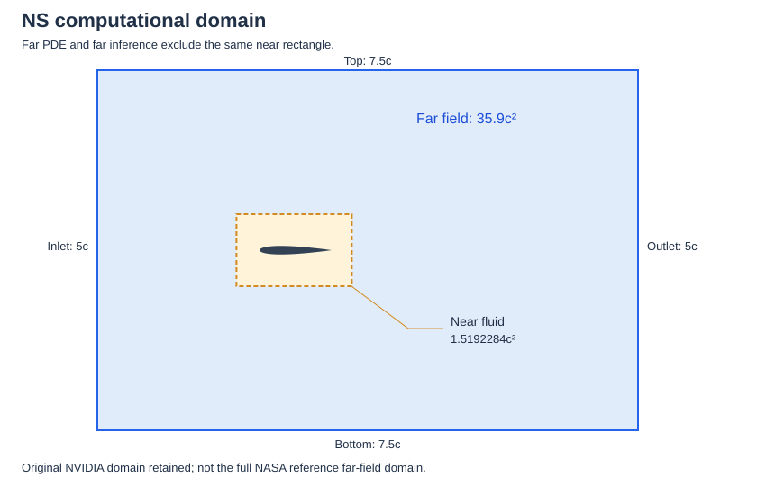
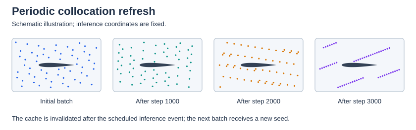

# N-S_noslip_corrected

Steady, two-dimensional incompressible Navier–Stokes PINN with physical no-slip, without a turbulence closure or wall functions. This is the independent NS comparator for [k_e_noslip](../k_e_noslip/).

## Origin and reproducibility

This executable is directly adapted from the [NVIDIA PhysicsNeMo Sym airfoil example](https://github.com/NVIDIA/physicsnemo-sym/tree/0c5f18c31d03d46ec0cc3ef4ccbf761a956dd38c/examples/airfoil_pinn). The upstream source is pinned to commit `0c5f18c31d03d46ec0cc3ef4ccbf761a956dd38c`; the upstream executable blob is `44de1e0ea5c07a64fb112f478dfb34da8a96397e`. Copyright notices and Apache-2.0 license are retained. Geometry, cache and preflight modules are byte-identical copies from the k-epsilon baseline at repository commit `a77da5765754b0bd5d87b00b183a1b1c1d4ec2c4`. This folder does not depend on importing files from the k-epsilon folder. The general history launcher is shared at [tools/archive_training.py](../tools/archive_training.py).

## Physical model

For constant density and viscosity, the native PhysicsNeMo NavierStokes PDE imposes

- continuity: u_x + v_y = 0
- x momentum: u u_x + v u_y + p_x - nu (u_xx + u_yy) = 0
- y momentum: u v_x + v v_y + p_y - nu (v_xx + v_yy) = 0

These are the incompressible equations on the continuity-satisfying solution; the native symbolic implementation is retained unchanged. With U_inf = c = rho = 1, Re = 6,000,000 and nu = 1/Re. The single fully connected network predicts u, v and p from x, y, alpha, camber and thickness. There is no k, epsilon, eddy viscosity, turbulence initialization or custom initialization aggregator. NS uses the original sum loss from NVIDIA. Consequently, this is a steady no-closure baseline, **not DNS or a physically validated turbulent-flow model** at this Reynolds number.

## Geometry and integration

The NASA TMR NACA 0012 analytic profile is

```text
y/c = +/- 0.594689181 * (0.298222773 sqrt(x/c)
      - 0.127125232 (x/c) - 0.357907906 (x/c)^2
      + 0.291984971 (x/c)^3 - 0.105174606 (x/c)^4)
```

The default nominal thickness parameter is 0.12; evaluating the published polynomial on the 501-point cosine grid gives actual maximum thickness 0.1189712189c. The boundary is approximated by 1,000 polygon segments with exact endpoint closure. Warp calculates signed point-to-segment distance, ray-crossing sign, unit normals and area weights. The boundary normal points out of the fluid (into the solid). Boundary sampling is uniform in polygon arc length; interior sampling rejects solid points while retaining the sampled geometric parameters. Continuous ranges remain available, but only the symmetric nominal 0.12 profile represents the TMR benchmark.



Near-field SDF retains the NVIDIA convention: minimum of signed airfoil distance and the distances to the near rectangle's horizontal boundaries. Artificial vertical interfaces are excluded from SDF weighting. The common far_criteria excludes the near rectangle from far training and inference.



| Constraint | Targets | Batch size | Total geometric measure |
|---|---|---:|---:|
| inlet | u=1, v=0 | 640 | 5 |
| outlet | p=0 | 640 | 5 |
| top_bot | u=1, v=0 | 640 | 15 |
| airfoil | u=0, v=0 | 512 | 2.039097523 |
| interior_far_field | continuity, momentum_x, momentum_y = 0 | 6000 | 35.9 |
| interior_near_field | same three residuals = 0 | 7000 | 1.519228358 |

The near PDE lambda is 2*max(sdf,0), as in NVIDIA and the k-epsilon comparator. Area weights are separate from lambda weights. The listed measures are for the fixed TMR profile, c=1. Solid area is 0.080771642. Top/bottom measure is two lengths of 7.5, not a manually tuned multiplier.

## Changes relative to the NVIDIA upstream example

| Component | NVIDIA upstream | N-S_noslip_corrected |
|---|---|---|
| Reynolds number | 50,000 | 6,000,000, configurable |
| Parameters | alpha -0.2 to 0 rad; camber 0 to 0.2; thickness 0.1 to 0.2 | fixed 0 rad, 0, 0.12 by default; ranges configurable |
| Profile | NACA polynomial with -0.1036 closure | NASA TMR scaled sharp-TE polynomial |
| Geometry backend | Warp | Warp retained |
| SDF | Union of thickness disks | Signed minimum point-to-segment distance |
| Resolution | 501 uniformly spaced chordwise samples | 501 cosine-spaced vertices per side |
| Surface samples | Projection from random points | Uniform arc-length sampling |
| Normals and SDF gradients | Finite differences and rejection of zero components | Guarded segment-distance gradients and valid unit normals |
| Quadrature | Channel measures reused | Correct polygon perimeter, fluid area and exact far/native measures |
| Domain | 7.5c x 5c; near 1.6c x 1c | Unchanged |
| PDE and BCs | Native NS, six constraints, physical no-slip | Unchanged |
| Near PDE weight | 2*max(sdf,0) | Unchanged |
| Far inference | Full channel | Shared far_criteria excluding near field |
| Sampling | Fixed dataset | Independent cached online batches refreshed every 1000 steps |
| Network | Single fully connected u,v,p network | Same topology; explicit 512-wide, 6-layer SiLU settings matching k-epsilon |
| Optimizer | Adam, framework default LR | Adam, LR 1e-4 |
| Scheduler | 0.95 decay per 2000 steps | 0.95 per 8000 steps |
| Far batch | 7000 | 6000 |
| Training budget | 1,000,000 | 1,000,000, unchanged |
| Inference groups | Seven | One active, six random groups commented |
| Boundary inference | 20,000 points sampled despite 512 batch size; field values only | 512 points; p, velocity gradients, normals and area |
| Checkpoints | Default framework path | network_checkpoint_ns_noslip_corrected |
| History | Latest results | Immutable 50,000-step snapshots using shared launcher |

## Dynamic sampling and history



The solver invalidates each constraint's cache after inference recording at steps 1000, 2000, etc. The next batch receives a new deterministic seed derived from the constraint name and refresh index. Common NS and k-epsilon constraints use identical seed schedules. This is periodic random resampling, not residual-adaptive refinement. CUDA graphs are disabled and num_workers=0. Inference coordinates are fixed; only near_field_1, boundary_1 and far_field_1 are active.

The shared archive launcher saves matched constraint and inference records at step 0 and every 50,000 steps in the actual network_dir/training_history. Each snapshot contains constraints/, inferencers/, config.yaml and manifest.json with file hashes. Expect 21 snapshots if all scheduled events complete through step 1,000,000. Native constraints are recorded every 10,000 steps and inference every 1,000 steps. Model checkpoints are not archived by this launcher. Use a fresh output path; do not mix histories from independent runs.

Boundary inference records p, u, v, u__x, u__y, v__x, v__y, normal_x, normal_y and area. First derivatives are computed by AD during inference only. With the stored fluid-outward normal n_f, the force on the solid is the negative of fluid boundary traction: p n_f - mu (grad U + grad U^T) n_f. Integrate the x component with area weights and divide by 0.5 rho U_inf^2 c for CD at zero AoA. Pressure and molecular-viscous components can be integrated separately. Absolute drag requires surface quadrature convergence; 512 samples are not a guarantee of sufficient accuracy.

## Execution

Use the existing single-GPU PhysicsNeMo Sym environment (legacy constraint API, e.g. 25.08), PyTorch, NumPy and Warp. The copied geometry and cache modules passed CPU and CUDA preflight in the k-epsilon run with Warp 1.10.0 and RTX 4500 Ada. The k-epsilon archive integration completed 1100 steps with two snapshots. The **new NS executable has not yet been run on that server**.

```bash
cd N-S_noslip_corrected
python -m compileall -q .
python preflight_geometry.py --device cpu
python preflight_geometry.py --device cuda:0
python ../tools/archive_training.py --self-test
python ../tools/archive_training.py --interval 1000 -- airfoil.py training.max_steps=1100 training.rec_constraint_freq=1000 network_dir=smoke_ns_corrected
# Expect six constraints, three inferencers, a cache reset at step 1000,
# and two nine-file snapshots if VTP is the only native output format.
python -u ../tools/archive_training.py -- airfoil.py
```

For a custom Reynolds number, pass custom.reynolds_number=... to both models. Run in a separate fresh checkpoint directory. The smoke test must complete before launching production training.

## Scientific limitations

Matching geometry, Reynolds number, domain, common residual weights and sampling settings improves comparability but does not isolate all optimization effects: NS has one network and sum loss, while k-epsilon has four networks and a turbulence initialization schedule. The original finite domain is much smaller than the NASA validation domain, and this model is incompressible rather than the low-Mach compressible reference. A million steps do not establish convergence. Check residuals, mass balance, symmetry, geometry and domain independence, surface quadrature sensitivity, Cp, Cf and CD (pressure and viscous components separately). At Re=6e6 a steady no-closure model does not represent turbulent Reynolds stresses and must not be labeled a validated turbulent prediction.

## References

1. [NVIDIA PhysicsNeMo Sym airfoil example, pinned source](https://github.com/NVIDIA/physicsnemo-sym/tree/0c5f18c31d03d46ec0cc3ef4ccbf761a956dd38c/examples/airfoil_pinn).
2. [NASA TMR NACA 0012 validation](https://tmbwg.github.io/turbmodels/naca0012_val.html).
3. [NASA TMR NACA 0012 numerical analysis and grid convergence](https://tmbwg.github.io/turbmodels/naca0012numerics_val.html).
4. [PhysicsNeMo Sym constraint API](https://docs.nvidia.com/physicsnemo/25.08/physicsnemo-sym/api/physicsnemo.sym.domain.constraint.html).
5. [NVIDIA Warp documentation](https://nvidia.github.io/warp/).
6. [PhysicsNeMo trainer recording implementation](https://docs.nvidia.com/physicsnemo/25.08/_modules/physicsnemo/sym/trainer.html).
