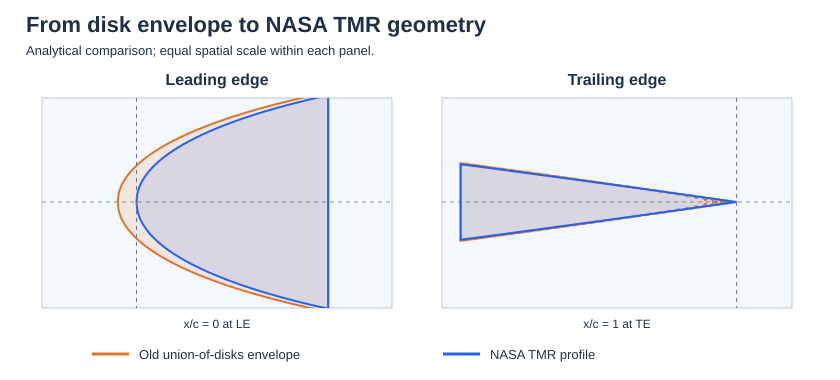
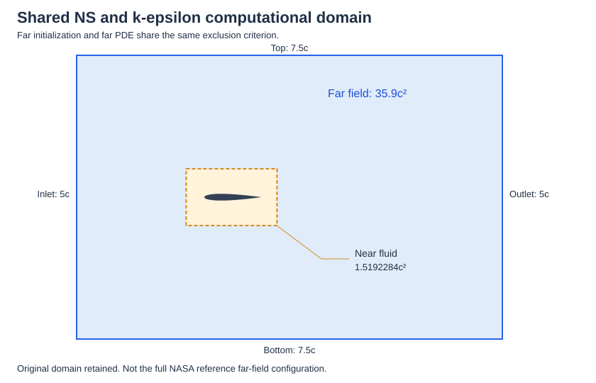
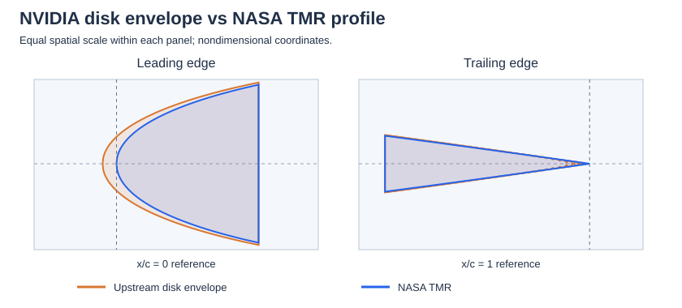
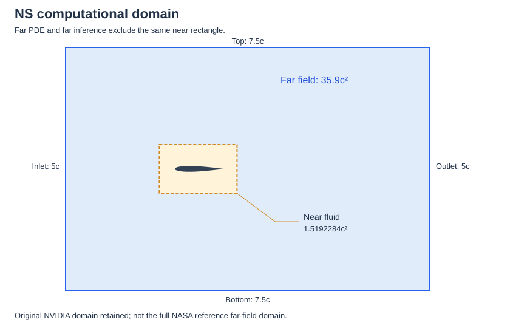
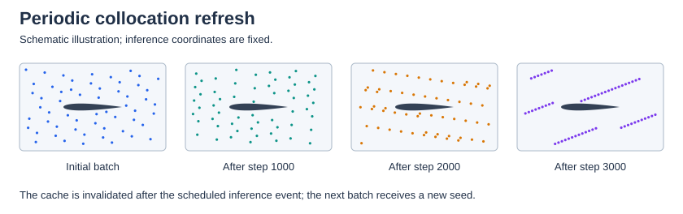

# PINNs for turbulent aerodynamics

Thesis research code for steady, two-dimensional incompressible external aerodynamics. This is the central methodology and change log. Model-specific READMEs describe governing equations, boundary treatment, execution and validation.

## Models

| Model | Physical interpretation | Executable | Documentation |
|---|---|---|---|
| NS no-slip | Steady NS, no turbulence closure | `N-S_noslip_corrected/airfoil.py` | [README](N-S_noslip_corrected/README.md) |
| k–ε no-slip | Standard high-Re RANS with physical no-slip and k=0 | `k_e_noslip/airfoil_ke_corrected.py` | [README](k_e_noslip/README.md) |
| k–ε WF | Same RANS equations with offset equilibrium wall treatment | `k_e_wf/airfoil_ke_wf.py` | [README](k_e_wf/README.md) |

The embedded `k_e_noslip/airfoil_ns.py` remains a matched NS comparator. All three variants are configured for 1,000,000 steps. Runtime preflight and smoke tests are required before production; no trained or validated results are claimed here.

## Provenance: distinguish NVIDIA upstream and thesis Ver1

The pinned [NVIDIA PhysicsNeMo Sym airfoil example](https://github.com/NVIDIA/physicsnemo-sym/tree/0c5f18c31d03d46ec0cc3ef4ccbf761a956dd38c/examples/airfoil_pinn) solves steady incompressible NS at Re=50,000 with parameterized NACA geometry, Warp sampling and physics-only training. The pinned [executable](https://github.com/NVIDIA/physicsnemo-sym/blob/0c5f18c31d03d46ec0cc3ef4ccbf761a956dd38c/examples/airfoil_pinn/naca/airfoil.py) has blob `44de1e0ea5c07a64fb112f478dfb34da8a96397e`; the pinned [configuration](https://github.com/NVIDIA/physicsnemo-sym/blob/0c5f18c31d03d46ec0cc3ef4ccbf761a956dd38c/examples/airfoil_pinn/naca/conf/config.yaml) has blob `e5d9177d3fa361e223c5fdacc32d5ea02d9b28b0`. Upstream contains no turbulence closure; its README notes the need for turbulence modeling at higher Re.

The intermediate [original thesis Ver1 project](https://github.com/georgios-giannakos/PINNs) is a different baseline (Re=1e6, NS and k–ε). The following two historical tables are therefore deliberately separate. The original NS table describes the standalone corrected NS model; most numerical and geometry changes apply to all variants. The subsequent RANS table extends the comparison to all three models.

### Standalone NS provenance

This executable is directly adapted from the [NVIDIA PhysicsNeMo Sym airfoil example](https://github.com/NVIDIA/physicsnemo-sym/tree/0c5f18c31d03d46ec0cc3ef4ccbf761a956dd38c/examples/airfoil_pinn). The upstream source is pinned to commit `0c5f18c31d03d46ec0cc3ef4ccbf761a956dd38c`; the upstream executable blob is `44de1e0ea5c07a64fb112f478dfb34da8a96397e`. Copyright notices and Apache-2.0 license are retained. Geometry, cache and preflight modules are byte-identical copies from the k-epsilon baseline at repository commit `a77da5765754b0bd5d87b00b183a1b1c1d4ec2c4`. The standalone NS folder does not depend on importing files from the k-epsilon folder. The general history launcher is shared at [tools/archive_training.py](tools/archive_training.py).

The WF model was built from k_e_noslip at commit `a40d7e1aefa28fec04a848884e6b09a238003b4f`; its initial implementation is commit `a492c1b262e33eb67db8172c48cabb5640b78506`.

## Changes relative to the NVIDIA upstream example

| Component | NVIDIA upstream | N-S_noslip_corrected |
|---|---|---|
| Reynolds number | 50,000 | 6,000,000, configurable |
| Parameters | alpha -0.2 to 0 rad; camber 0 to 0.2; thickness 0.1 to 0.2 | fixed 0 rad, 0, 0.12 by default; ranges configurable |
| Profile | NACA polynomial with -0.1036 closure | NASA TMR scaled sharp-TE polynomial |
| Geometry backend | Warp | Warp retained |
| SDF | Union of thickness disks | Signed minimum point-to-segment distance |
| Resolution | 501 uniformly spaced chordwise samples | 501 cosine-spaced vertices per side |
| Surface samples | Projection from random points | Uniform arc-length sampling |
| Normals and SDF gradients | Finite differences and rejection of zero components | Guarded segment-distance gradients and valid unit normals |
| Quadrature | Channel measures reused | Correct polygon perimeter, fluid area and exact far/native measures |
| Domain | 7.5c x 5c; near 1.6c x 1c | Unchanged |
| PDE and BCs | Native NS, six constraints, physical no-slip | Unchanged |
| Near PDE weight | 2*max(sdf,0) | Unchanged |
| Far inference | Full channel | Shared far_criteria excluding near field |
| Sampling | Fixed dataset | Independent cached online batches refreshed every 1000 steps |
| Network | Single fully connected u,v,p network | Same topology; explicit 512-wide, 6-layer SiLU settings matching k-epsilon |
| Optimizer | Adam, framework default LR | Adam, LR 1e-4 |
| Scheduler | 0.95 decay per 2000 steps | 0.95 per 8000 steps |
| Far batch | 7000 | 6000 |
| Training budget | 1,000,000 | 1,000,000, unchanged |
| Inference groups | Seven | One active, six random groups commented |
| Boundary inference | 20,000 points sampled despite 512 batch size; field values only | 512 points; p, velocity gradients, normals and area |
| Checkpoints | Default framework path | network_checkpoint_ns_noslip_corrected |
| History | Latest results | Immutable 50,000-step snapshots using shared launcher |

### Additional physics and training changes relative to NVIDIA

| Component | NVIDIA upstream NS | k–ε no-slip | k–ε WF |
|---|---|---|---|
| PDE | Native steady NS | Standard high-Re RANS: full symmetric stress and k/ε transport | Identical RANS PDE |
| Pressure | Native NS p | Mean static p, explicit 2/3 grad(k) | Same |
| Network | Single u,v,p network | Four networks (u,v),p,k_star,ep_star | Same topology |
| Turbulence positivity | None | Inlet-scaled stable softplus, floor 1e-12 | Shifted wall-scale softplus, same floor and inlet values |
| Eddy viscosity | None | C_mu k²/(ε+1e-20) | Same |
| Inlet / top / bottom | u=1,v=0 | Also k_inf,ep_inf | Same |
| Initialization | None | Normalized freestream targets in near and far regions | Same far targets; near-wall equilibrium-scale warm start |
| Loss | Sum | Fixed tanh schedule centered at 20k | Same schedule, fixed wall lambdas, no adaptive weighting |
| Wall | Physical no-slip | Physical u=v=k=0 (positive k floor) | Offset P; normal velocity, tangential equilibrium, signed shear, blended ε |
| Near samples | Original solid rejection | Correct polygon rejection | Also excludes unresolved wall layer |
| Parameters | Continuous ranges | Configurable, fixed benchmark default | Fixed nominal NACA 0012, alpha=0 |
| Surface inference | Field values | AD velocity derivatives, normals and area, k/ep | Physical coordinates mapped to P, modeled and RANS shear, y+ |
| Force evaluation | ParaView fields | Pressure/molecular-viscous traction integration | WF-specific Cp/Cf CSV, pressure/friction CD and CL |
| Monitors | Standard | Standard | Wall diagnostics every 1k |

## Changes relative to intermediate Ver1

Sources: [original Ver1 NS](https://github.com/georgios-giannakos/PINNs/tree/main/models/Ver1/navier-stokes), [original Ver1 k-epsilon](https://github.com/georgios-giannakos/PINNs/tree/main/models/Ver1/k-epsilon). The k-epsilon PDE and executable build on the supplied corrected files (no-slip release). The changes below distinguish those inherited corrections from this release's geometry and sampling work.

| Component | Original Ver1 | This release | Reason |
|---|---|---|---|
| Profile | Closed TE using -0.1036 | NASA TMR scaled polynomial | Match published geometry |
| Backend | Warp | Warp | Retain GPU geometry and parameterization |
| SDF | Union of disks | Signed segment distance | Correct contour and sign |
| Resolution | 501 chordwise samples | 501 cosine-spaced points per side | Resolve LE and TE |
| Boundary points | Projection from random queries | Uniform polygon arc length | Consistent integration |
| Normals | Zero-component normals rejected; finite-difference normalization | Unit segment normals; guarded distance gradients | Correct orientation and numerical safety |
| Area | Channel boundary/interior measures reused | Actual perimeter, fluid area and exact far area | Correct quadrature |
| Far init | Absent in original; unfiltered in corrected upload | Common far_criteria | Exclude near region and solid |
| Far inference | Full rectangle in original NS | Common far_criteria | Match training region |
| Sampling | Fixed dataset | Online cached batches, 1000-step refresh | Periodic collocation refresh |
| RANS stress (inherited correction) | Scalar diffusion approximation | Symmetric stress divergence and 2/3 grad(k) | Mean static pressure formulation |
| Turbulence viscosity (inherited) | Large denominator guard | 1e-20 guard | Preserve freestream viscosity ratio |
| Turbulence outputs (inherited) | Clipped symbolic softplus, floor 1e-4 | Stable scaled PyTorch softplus, floor 1e-12 | Represent small freestream values |
| Initialization (inherited) | Separate target prescription | Same targets as inlet, normalized residuals | Consistency and scaling |
| PDE scales (inherited) | Unscaled k/epsilon residuals | Fixed k_ref=1e-3, ep_ref=1e-2 | Retain corrected model |
| k-epsilon aggregator | Tanh transition | Unchanged | Preserve initialization schedule |
| Reynolds | 1e6 | 6e6 for both, configurable | Match NASA Re and compare models |
| Training budget | NS 200k; k-epsilon 400k | 1M for both | Thesis study budget |
| NS numerical settings | Original NS defaults | Matched 512-wide 6-layer SiLU settings, Adam 1e-4, decay 0.95/8000 and common batches | Reduce numerical confounders |
| Network structure | NS single network; k-epsilon four | Retained | Preserve model definitions |
| Domain and BCs | Original rectangle and no-slip | Retained | Baseline comparability |
| Near PDE lambda | 2*max(sdf,0) | Retained | Preserve weighting convention |
| Checkpoints | Historical paths | Separate NS and k-epsilon paths | Avoid cross-model overwrite |
| Inference groups | Seven groups, redundant at fixed parameters | One active group, six commented | Fixed 0-degree study |
| Boundary inference | Field predictions only | Normals, area and first velocity derivatives added | Enable traction post-processing |
| Training history | Native files overwritten | Exact-step archives via optional shared launcher | Preserve thesis field evolution |

## Geometry, normals and integration

NASA TMR extends the original NACA section to its natural sharp trailing edge and scales it to unit chord. The published symmetric profile is

```text
y/c = +/- 0.594689181 * (0.298222773 sqrt(x/c)
      - 0.127125232 (x/c) - 0.357907906 (x/c)^2
      + 0.291984971 (x/c)^3 - 0.105174606 (x/c)^4)
```



The shared Warp module discretizes this formula with 501 cosine-spaced points per side, giving 1,000 unique polygon segments. Endpoints close exactly despite rounding of the published coefficients. The resulting numerical contour approximates the analytic TMR profile, not an exact continuous signed-distance solution.

The old union-of-disks SDF is replaced by the minimum distance to projected points on segments. The sign is determined by half-open ray crossing. With counterclockwise solid vertices, the boundary normal is the left normal, pointing into the solid (out of the fluid). Axis-aligned normals are valid. A zero-distance guard avoids division by zero, and positive fluid distance and unit normals/gradients are checked at sampling time.

The original near-field weighting convention is preserved: SDF is the minimum of airfoil distance and distances to near top/bottom, excluding the artificial x interfaces. Near PDE lambda remains 2*max(sdf,0). The polygon is sampled uniformly in arc length; interior points use conditional rejection. The Warp implementation supports continuous tuple ranges of alpha, camber and nominal thickness; generalized cambered/scaled sections are not themselves NASA validation geometries. All profiles must fit the near rectangle.



| Constraint | Total geometric measure (c=1) | Batch size |
|---|---:|---:|
| inlet | 5 | 640 |
| outlet | 5 | 640 |
| top_bot | 15 | 640 |
| airfoil | 2.0390975 | 512 |
| interior_near_field / interior_init | 1.5192284 | 7000 |
| interior_far_field / interior_init_far_field | 35.9 | 6000 |

These are independently calculated double-precision polygon measures, not measured Warp outputs. Solid area=0.080771642 and maximum thickness=0.11897122. The NASA TMR page describes the maximum thickness as approximately 0.11894c; evaluating its published coefficients on the 501-point cosine grid gives 0.1189712189c. The preflight now tests this polynomial-derived value directly, without changing the geometry. Each sample carries its conditional geometric measure divided by batch size. Area weights implement spatial quadrature and are distinct from PDE lambda weights. Top/bottom totals 2 × 7.5, not a tunable loss multiplier.

The physical polygon is unchanged for WF. Its resolved near area is reduced by L_wall*d + pi*d² and the computational boundary perimeter is approximately L_wall+2*pi*d for the convex polygon. Force integration retains the physical-wall quadrature. See [WF geometry](k_e_wf/README.md#offset-geometry).

### Standalone NS measures and original diagram copies

| Constraint | Targets | Batch size | Total geometric measure |
|---|---|---:|---:|
| inlet | u=1, v=0 | 640 | 5 |
| outlet | p=0 | 640 | 5 |
| top_bot | u=1, v=0 | 640 | 15 |
| airfoil | u=0, v=0 | 512 | 2.039097523 |
| interior_far_field | continuity, momentum_x, momentum_y = 0 | 6000 | 35.9 |
| interior_near_field | same three residuals = 0 | 7000 | 1.519228358 |





The original standalone NS geometry and integration text is retained in the [historical README](https://github.com/georgios-giannakos/PINNs-for-turbulent-aerodynamics/blob/a492c1b262e33eb67db8172c48cabb5640b78506/N-S_noslip_corrected/README.md#geometry-and-integration). The shared method preserves sampled parameter values during rejection, the near SDF excludes vertical interfaces and far_criteria excludes the near rectangle in far training and inference. The physical polygon is only an approximation to the TMR analytical profile.

## Dynamic sampling



The solver uses a post-inference cache invalidation strategy at steps 1000, 2000, etc. Every constraint has a separate cache and deterministic seed derived from its name and refresh index. Common constraint names use the same seed schedule in NS and k-epsilon. The next batch after the event is new; this is periodic random resampling, not residual-based adaptive sampling. CUDA graphs are disabled and num_workers=0. Only the nominal 0-degree inference group is active in this baseline (near_field_1, boundary_1, far_field_1). The six random inference groups remain commented out for future parametric runs. Inference points are generated before training and remain fixed.


The named seed schedules are shared across models but spatial samples need not be identical when the resolved geometry differs. Wall diagnostics do not drive resampling or adaptive weighting.

## Matched numerical specification

| Setting | Value |
|---|---|
| Benchmark | NASA TMR NACA 0012, alpha=0, thickness=0.12, camber=0, Re=6e6, U=c=rho=1 |
| Outer rectangle | x [-2.25,5.25], y [-2.5,2.5] |
| Near rectangle | x [-0.32,1.28], y [-0.5,0.5] |
| Networks | Four decoupled fully connected (u,v),p,k_star,ep_star; width 512, 6 layers, SiLU |
| Optimizer | Adam 1e-4, decay 0.95/8000 |
| Training | 1M steps; CUDA graphs off, zero workers |
| Batches | inlet/outlet/top_bot 640, airfoil 512, near 7000, far 6000 |
| Sampling | Same per-constraint seed and cache refresh every 1000 steps after inference |
| Recording | inference and monitors 1k, constraints 10k, optional history 50k |
| Outer BC | u=1,v=0,k_inf,ep_inf at inlet/top/bottom; p=0 at outlet |
| RANS | Byte-identical complete symmetric stress divergence, mean static p, 2/3 grad(k), fixed k_ref=1e-3, ep_ref=1e-2 |
| PDE weights | Same far weights and near 2*max(physical SDF,0) |

At Re=6e6, nu=1/6e6, k_inf=1.5e-6, ep_inf=1.215e-7 (I=0.001, viscosity ratio 10). The geometry, RANS PDE, original aggregator, cache and solver files are copied unchanged. Near and wall coordinates necessarily differ because of the unresolved layer.

The network and RANS rows above describe the two k–ε variants; NS instead retains a single u,v,p network, native NS equations and sum loss. The outer BC turbulence fields apply only to RANS; additional monitors apply only to WF. The matched settings reduce confounders but the WF-specific initialization, output mapping, geometry and wall residuals are additional differences.

## Step-indexed training history

The reusable [archive launcher](tools/archive_training.py) preserves constraints and inferencers at step 0 and every 50,000 steps, while training continues. The legacy PhysicsNeMo Sym trainer normally overwrites its result files. The launcher hooks the actual constraint and inference recording events, captures only files written at the matching step, then writes immutable bytes with a background thread. A completed snapshot is published atomically with a manifest and the run configuration. There is no polling, second GPU process, or change to sampling/optimization. Recording frequencies remain 10,000 (constraints) and 1,000 (inference); both divide 50,000.

```bash
# From k_e_noslip/, start a fresh run with history.
python ../tools/archive_training.py -- airfoil_ke_corrected.py
# For an archive outside the repository, supply a unique path:
python ../tools/archive_training.py --archive-dir /path/to/history/ke_run -- airfoil_ke_corrected.py
# The same launcher works for other legacy PhysicsNeMo Sym training executables.
python ../tools/archive_training.py -- airfoil_ns.py
```

Default output location: the actual PhysicsNeMo network_dir/training_history, including Hydra's run path. Each step directory contains constraints/, inferencers/, config.yaml and manifest.json (sizes and SHA-256 hashes). A fresh run through step 1,000,000 produces 21 snapshots if every scheduled recording succeeds. Existing snapshots are retained on a same-run restart; do not reuse an archive directory across independent runs. If a final step is not a multiple of the interval, it is not archived automatically. Plain execution of the model file does not activate the launcher. This script assumes the legacy single-process Trainer recording API and native output directories; it fails on incompatible recording intervals or missing result files. It does not archive model or optimizer checkpoints.

### Surface data for drag analysis

The fixed boundary_1 inferencer now records p, u, v, the four first velocity derivatives (u__x, u__y, v__x, v__y), normal_x, normal_y and area, plus k and ep for k-epsilon. The derivatives are obtained by automatic differentiation (requires_grad=True) in inference only. The normals point out of the fluid, into the solid; area is the arc-length quadrature weight. These fields enable separate pressure and molecular-viscous traction integration, subject to the limitations of this baseline and the 512-point random arc-length quadrature. The fixed coordinates help compare training steps; accurate absolute drag still requires surface quadrature convergence. Wall-function models need their own shear-stress outputs and post-processing conventions; the archive launcher itself is model-agnostic. No drag coefficients are calculated automatically.

References: [Trainer recording implementation](https://docs.nvidia.com/physicsnemo/25.08/_modules/physicsnemo/sym/trainer.html), [PointwiseInferencer API](https://docs.nvidia.com/physicsnemo/25.08/physicsnemo-sym/api/physicsnemo.sym.domain.inferencer.html).

### Standalone NS traction convention

Boundary inference records p, u, v, u__x, u__y, v__x, v__y, normal_x, normal_y and area. First derivatives are computed by AD during inference only. With the stored fluid-outward normal n_f, the force on the solid is the negative of fluid boundary traction: p n_f - mu (grad U + grad U^T) n_f. Integrate the x component with area weights and divide by 0.5 rho U_inf^2 c for CD at zero AoA. Pressure and molecular-viscous components can be integrated separately. Absolute drag requires surface quadrature convergence; 512 samples are not a guarantee of sufficient accuracy.

For WF, use its modeled signed traction and physical mapped wall coordinates instead (see [model-specific reconstruction](k_e_wf/README.md#inference-monitors-and-force-integration)). The common archive launcher does not calculate coefficients.

## Verification and scientific limitations

- Historical reports differ by revision: the earlier k–ε README records a step-1000 finite loss of 0.002610 and cache reset (not proof of changed step-1001 coordinates or completion); the later standalone NS README reports a completed 1100-step k–ε archive integration with two snapshots. This is a reported later status, not a new test.
- Geometry/cache preflight reportedly passed CPU and CUDA (Warp 1.10.0, CUDA 12.8, RTX 4500 Ada). It does not certify the standalone NS executable or the new WF wrapper.
- The finite domain is much smaller than NASA TMR and the formulation is incompressible, not the low-Mach compressible reference. Matching Re and geometry is not full benchmark reproduction.
- Steady NS is not DNS and high-Re k–ε without wall treatment is not a complete near-wall closure. A million steps do not establish convergence.
- Compare residuals, mass conservation, symmetry, domain/geometry sensitivity, quadrature, Cp, Cf, pressure/friction CD and CL; record versions, actual step, seed, commit and pressure reference.

## References

1. [Pinned NVIDIA airfoil example](https://github.com/NVIDIA/physicsnemo-sym/tree/0c5f18c31d03d46ec0cc3ef4ccbf761a956dd38c/examples/airfoil_pinn).
2. [NASA TMR NACA 0012 validation](https://tmbwg.github.io/turbmodels/naca0012_val.html).
3. [NASA TMR grid convergence](https://tmbwg.github.io/turbmodels/naca0012numerics_val.html).
4. Launder and Spalding (1974), [The numerical computation of turbulent flows](https://doi.org/10.1016/0045-7825%2874%2990029-2), CMAME 3(2), 269–289.
5. [PhysicsNeMo constraint API](https://docs.nvidia.com/physicsnemo/25.08/physicsnemo-sym/api/physicsnemo.sym.domain.constraint.html), [inferencer API](https://docs.nvidia.com/physicsnemo/25.08/physicsnemo-sym/api/physicsnemo.sym.domain.inferencer.html), [monitor API](https://docs.nvidia.com/physicsnemo/25.08/physicsnemo-sym/api/physicsnemo.sym.domain.monitor.html), [trainer recording](https://docs.nvidia.com/physicsnemo/25.08/_modules/physicsnemo/sym/trainer.html).
6. [NVIDIA Warp](https://nvidia.github.io/warp/).
7. [Original thesis PINNs project](https://github.com/georgios-giannakos/PINNs).
8. [OpenFOAM epsilonWallFunction](https://doc.openfoam.com/2312/tools/processing/boundary-conditions/rtm/derived/wall/epsilonWallFunction/).

Applicable NVIDIA Apache-2.0 notices are retained; new modules use Apache-2.0 SPDX identifiers. The complete pre-reorganization documentation is preserved in [this commit](https://github.com/georgios-giannakos/PINNs-for-turbulent-aerodynamics/tree/a492c1b262e33eb67db8172c48cabb5640b78506).
