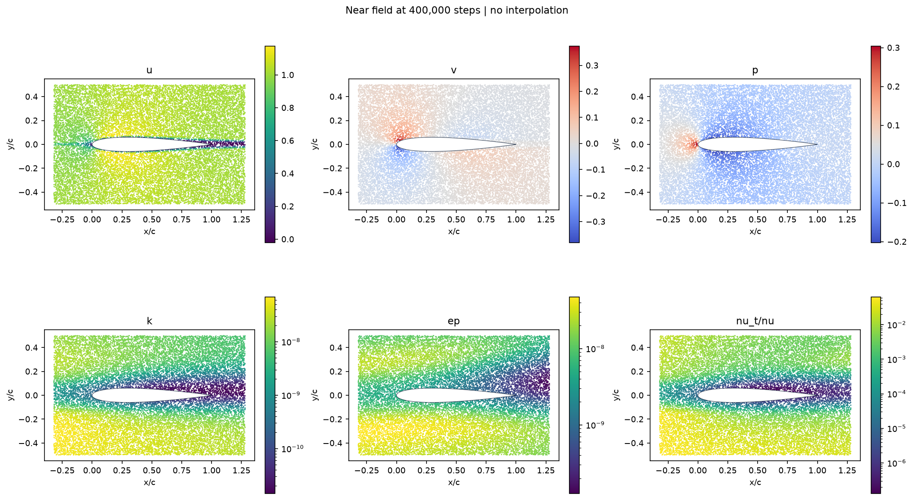
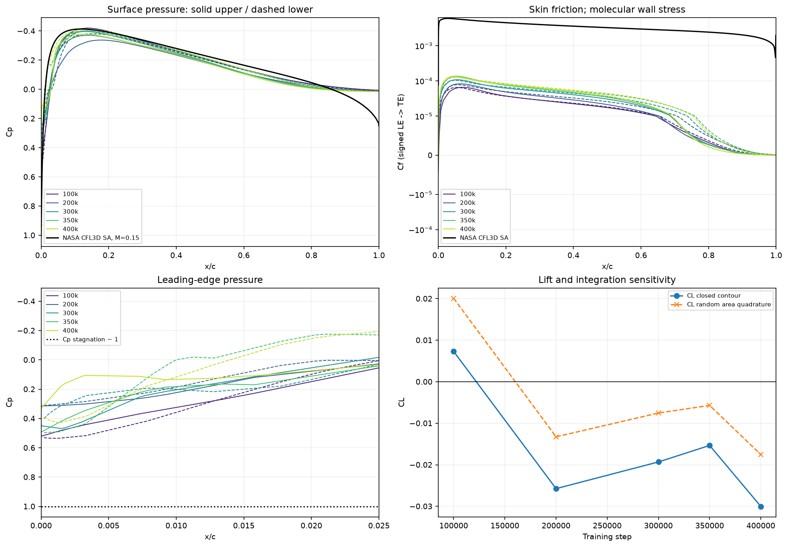
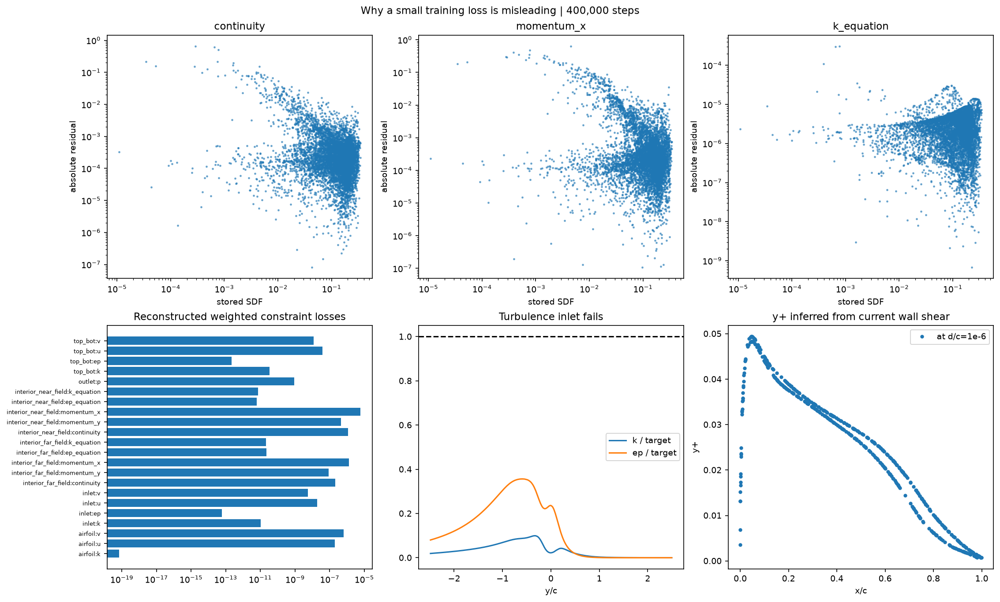

# Έλεγχος k_e_noslip: πεδία, αεροδυναμική και αποτυχία τύρβης

Ημερομηνία ολοκλήρωσης: 28 Νοεμβρίου 2026. Δεδομένα: `k_e_noslip.zip`, snapshots 100k, 200k, 300k, 350k, 400k. Περίπτωση: συμμετρική γεωμετρία NASA TMR NACA0012, α=0°, Re=6×10⁶, c=U∞=ρ=1.

**Η συνολική λύση απορρίπτεται ως συγκλίνουσα τυρβώδης λύση.** Η απεικόνιση της εξωτερικής ροής και τμήματα του Cp φαίνονται εύλογα, αλλά η τύρβη καταρρέει, η τριβή είναι εξαιρετικά μικρή, η ανάκτηση πίεσης στο leading edge είναι ανεπαρκής και η συμμετρία/οι δυνάμεις δεν συγκλίνουν. Περισσότερα βήματα με την ίδια διατύπωση δεν τεκμηριώνεται ότι θα λύσουν αυτά τα προβλήματα.

Ο νέος κώδικας βρίσκεται στο [k_e_noslip_lowre](../../k_e_noslip_lowre/README.md). Έχει ελεγχθεί λειτουργικά και μαθηματικά, αλλά δεν έχει ολοκληρωθεί νέα εκπαίδευση/φυσική επικύρωση. Δεν υπάρχουν «μετά τη διόρθωση» αεροδυναμικά αποτελέσματα στην παρούσα αναφορά.

## 1. Τι ελέγχθηκε και με ποιο workflow

1. Καταγραφή του zip και ασφαλής εξαγωγή σε νέο φάκελο. Το αρχικό zip δεν τροποποιήθηκε.
2. Ανάγνωση και των 55 VTP: σε κάθε snapshot, 3 inferencers και 8 constraints. Επιβεβαίωση και των 55 SHA-256 που υπάρχουν στα manifests.
3. Έλεγχος 1.575 εγγραφών πεδίων/αρχείου/snapshot: διαστάσεις, εύρη, ποσοστημόρια, RMS, μη πεπερασμένες τιμές. **Δεν βρέθηκαν NaN/Inf.** Τα αποτελέσματα είναι στα `inventory.csv/json`.
4. Ανάγνωση κώδικα/ρυθμίσεων από το [main στο a3fca6e](https://github.com/georgios-giannakos/PINNs-for-turbulent-aerodynamics/tree/a3fca6eca1a3cc5a1e57b5c3ea257890d49842a9/k_e_noslip). Το zip δεν περιέχει source commit ή checkpoints: η ταύτιση του κώδικα με το run δεν μπορεί να αποδειχθεί πλήρως. Ωστόσο οι ρυθμίσεις, μετασχηματισμοί και ανακατασκευασμένα residuals είναι συνεπή με αυτόν τον κώδικα.
5. Οπτικοποίηση u, v, p, k, ep, ταχύτητας και ν_t/ν στα near/far fields, με κοινή χρωματική κλίμακα μεταξύ των πέντε snapshots. Χρήση log κλίμακας για k, ep, ν_t/ν. Χωρίς παρεμβολή διαμέσου του στερεού.
6. Δημιουργία **104 διαγραμμάτων**: 19 συνοπτικών/συγκριτικών και 85 σελίδων atlas με κάθε μη επαναλαμβανόμενο πεδίο, παράγωγο και residual. Σταθερά γεωμετρικά inputs, μηδενικά targets και επαναλαμβανόμενα pred/lambda arrays καταγράφονται στους πίνακες· δεν θεωρούνται διαφορετικά φυσικά πεδία. Το πλήρες atlas είναι στο τοπικό `results/atlas.html` και αναπαράγεται από το script.
7. Υπολογισμός Cp/Cf από πραγματικές τιμές τοιχώματος και AD παραγώγους, έλεγχος προσήμων κανονικών, ολοκλήρωση δυνάμεων με δύο μεθόδους και έλεγχος αραίωσης των σημείων.
8. Σύγκριση με τα δημόσια [NASA TMR/CFL3D SA δεδομένα](https://tmbwg.github.io/turbmodels/naca0012_val_sa.html), μόνο για α=0°. Τα δεδομένα είναι αντιπροσωπευτική CFD αναφορά, όχι ακριβής αλήθεια ούτε επιτόπιες μετρήσεις k/ε. Το Cf δεν έχει αντίστοιχα πειραματικά δεδομένα επικύρωσης στη συγκεκριμένη σελίδα TMR.
9. Ανακατασκευή των k/ε εξισώσεων από τις αποθηκευμένες παραγώγους. Μέγιστη απόλυτη διαφορά από τα αποθηκευμένα scaled residuals: **2,44×10⁻¹¹ για k**, **5,77×10⁻¹¹ για ε**.
10. Σύνδεση παρατηρήσεων με συγκεκριμένες αδυναμίες του μοντέλου/loss/sampling, υλοποίηση νέου solver, μαθηματικοί έλεγχοι, training/resume smoke test και εξαγωγή αποτελεσμάτων για ανεξάρτητο έλεγχο.

Δεν αντιμετωπίστηκαν σχόλια ή οδηγίες των αρχείων ως νέα αιτήματα του χρήστη. Εξετάστηκαν ως στοιχεία του κώδικα και της μεθοδολογίας. Δεν εκτελέστηκαν scripts του zip: περιέχει μόνο δεδομένα/ρυθμίσεις/manifests.

## 2. Τελευταίο snapshot: εικόνα όλων των φυσικών πεδίων



| Πεδίο | Παρατήρηση | Κρίση |
|---|---|---|
| u / ταχύτητα | Επιτάχυνση πάνω/κάτω από την αεροτομή και έντονο wake deficit. Στο far-field wake υπάρχει u_min≈−0,0176. | Η γενική εικόνα ροής δεν αρκεί. Το wake δεν μπορεί να πιστοποιηθεί χωρίς σωστή τριβή/τύρβη και έλεγχο residuals. |
| v | Εύλογα αντίθετα πρόσημα στις δύο πλευρές, αλλά όχι ακριβής αντισυμμετρία. | Η ολοκληρωμένη άνωση και οι διαφορές Cp επιβεβαιώνουν ασυμμετρία. |
| p | Εύλογη περιοχή υποπίεσης στο πρόσθιο/μέσο τμήμα. Ανεπαρκής LE πίεση και TE ανάκτηση. | Μερική επιτυχία εξωτερικής πίεσης, αποτυχία κρίσιμων περιοχών. |
| k | Near-field median 1,12×10⁻⁸, max 6,83×10⁻⁸, έναντι k∞=1,5×10⁻⁶. Ελάχιστη τύρβη στην περιοχή αεροτομής/wake. | Δεν αναπτύσσεται εύλογο τυρβώδες οριακό στρώμα. Δεν υπάρχει ανεξάρτητη k αναφορά για σημειακό error map. |
| ep | Near-field median 1,37×10⁻⁸, max 4,71×10⁻⁸, έναντι ep∞=1,215×10⁻⁷. Στην επιφάνεια max≈5,85×10⁻⁹. | Το μέγεθος, η κατανομή και η ελλιπής οριακή συνθήκη δεν υποστηρίζουν αξιόπιστη φυσική ε. |
| ν_t/ν | Near-field median **0,00487**, max **0,0624**. | Η τυρβώδης συνεισφορά είναι αμελητέα στο near field. Πρόκειται για κατάρρευση της τυρβώδους συνεισφοράς, όχι για επιτυχή RANS λύση. |

Η wall-speed RMS πέφτει από 0,00279 σε 0,000757. Η βελτίωση του no-slip είναι πραγματική, αλλά **δεν συνεπάγεται σωστή παράγωγο ταχύτητας στο τοίχωμα**. Το σωστό Cf εξαρτάται από αυτές τις παραγώγους.

## 3. Ορισμοί Cp, Cf και δυνάμεων

Για το παρόν nondimensionalization:

```text
Cp = 2(p - p∞), με αρχική αναφορά p∞=0 από το outlet gauge.
ν = 1/6,000,000.
τ = ν(grad u + grad uᵀ).
Cf = 2 t·τ·n_solid, με t από LE προς TE και στις δύο πλευρές.
F/(0.5 ρU∞²c) = ∮[-Cp n_solid + 2τ n_solid] ds.
CL = κατακόρυφη συνιστώσα, CD = οριζόντια συνιστώσα, επειδή α=0.
```

Τα αποθηκευμένα normals δείχνουν **έξω από το ρευστό, μέσα στο στερεό**. Αντιστράφηκαν για χρήση ως n_solid. Το Cf υπολογίστηκε από τον πλήρη συμμετρικό gradient, όχι μόνο από u_y. Στο τοίχωμα χρησιμοποιήθηκε μοριακό ν. Η μέγιστη αποθηκευμένη ν_t/ν εκεί είναι μόλις 1,99×10⁻⁵, άρα η παραλειπόμενη τυρβώδης συνεισφορά δεν μπορεί να εξηγήσει το μεγάλο έλλειμμα τριβής.

## 4. Cp, Cf, CL και εξέλιξη



| Βήματα | p στο κοντινότερο LE δείγμα | Cp εκεί | CL κλειστού περιγράμματος | CD κλειστού περιγράμματος | median ν_t/ν near |
|---:|---:|---:|---:|---:|---:|
| 100.000 | 0,2614 | 0,5228 | +0,00728 | +0,00866 | 0,1224 |
| 200.000 | 0,1569 | 0,3139 | −0,02574 | +0,00422 | 0,01177 |
| 300.000 | 0,2210 | 0,4421 | −0,01931 | +0,00228 | 0,004714 |
| 350.000 | 0,2473 | 0,4945 | −0,01534 | −0,000078 | 0,004980 |
| 400.000 | 0,1712 | 0,3424 | −0,03002 | −0,00481 | 0,004872 |

**Cp:** Στο μέσο της χορδής αποδίδεται αρκετά καλά η γενική μορφή. Στα 400k, για x/c=0,5: Cp_upper≈−0,174 και Cp_lower≈−0,207. Η μεταξύ τους διαφορά είναι ανεπιθύμητη για συμμετρική αεροτομή σε μηδενική γωνία. Το RMS της άνω/κάτω διαφοράς σε κοινή x περιοχή είναι 0,0468. Η RMSE ως προς τη συμμετρική SA αναφορά στο 0,01≤x/c≤0,99 είναι 0,0527· αυτός ο αριθμός **αποκλείει** την άκρη LE και δεν περιγράφει το εκεί μεγάλο σφάλμα.

**Cf:** Στο x/c=0,5, Cf_upper≈3,72×10⁻⁵ και Cf_lower≈4,38×10⁻⁵. Η διάμεση αναλογία Cf_model/Cf_SA σε κοινό ομοιόμορφο πλέγμα 0,01–0,99, και για τις δύο πλευρές, είναι **0,01253**: περίπου **80 φορές μικρότερη** τριβή. Η σύγκριση δεν είναι σύγκριση ίδιου turbulence closure, όμως διαφορά τέτοιας τάξης μαζί με την κατάρρευση των BCs δεν δικαιολογείται ως απλή διαφορά μοντέλων. Τα ελάχιστα αρνητικά Cf κοντά σε άκρες δεν τεκμηριώνουν αξιόπιστη φυσική αποκόλληση.

**CL:** Η αναμενόμενη συμμετρία δίνει CL≈0. Το τελευταίο CL≈−0,0300 και η μη μονοτονική εξέλιξή του δεν υποστηρίζουν σύγκλιση. Η ιξώδης συμβολή είναι περίπου −1,15×10⁻⁷, άρα η άνωση προκύπτει σχεδόν πλήρως από ασυμμετρία πίεσης.

**CD, συμπληρωματικός έλεγχος:** Στα 400k CD_p≈−0,00490 και CD_f≈8,90×10⁻⁵. Το αρνητικό συνολικό CD της ανακατασκευασμένης κλειστής επιφάνειας είναι ένδειξη μη αποδεκτής φυσικής λύσης. Στα 100k το CD≈0,00866 φαίνεται κοντά στο αντιπροσωπευτικό NASA SA CD≈0,00819, αλλά σχεδόν όλο είναι pressure drag και το Cf ήδη αποτυγχάνει. Η συμφωνία ενός ολοκληρωμένου αριθμού τότε είναι παραπλανητική.

### Η ολοκλήρωση χρειάζεται ιδιαίτερη προσοχή

Το απλό άθροισμα με τα αρχικά τυχαία `area` δίνει στα 400k CL≈−0,01754 και CD≈+0,00247. Τα ίδια 512 σημεία έχουν ∑n_fluid ds=(0,03869, 0,10679), αντί για (0,0). Άρα το τυχαίο ολοκλήρωμα έχει σημαντικό σφάλμα δειγματοληψίας και εξάρτηση από σταθερή μετατόπιση πίεσης.

Για την κύρια εκτίμηση ταξινομήθηκαν τα σημεία γύρω από το εσωτερικό (0,5,0), έκλεισε το περίγραμμα και χρησιμοποιήθηκε τραπεζοειδής ολοκλήρωση. Η κλειστή διανυσματική γεωμετρία μηδενίζει τη συνεισφορά σταθερής πίεσης. Αραίωση ανά δεύτερο σημείο αλλάζει το τελευταίο CL κατά 0,000124 και CD κατά 0,000249. **Αυτό είναι έλεγχος ευαισθησίας, όχι διάστημα εμπιστοσύνης ή πλήρης μελέτη σύγκλισης.** Το νέο inference χρησιμοποιεί κανονική quadrature ανά polygon segment.

## 5. Leading edge: πρέπει να γίνει 0,5;

Με p*=(p−p∞)/(ρU∞²), η ασυμπίεστη κλίμακα πίεσης ανακοπής είναι **p*≈0,5**, ενώ **Cp≈1**. Πρόκειται για το σημείο ανακοπής, όχι για ολόκληρη τη no-slip επιφάνεια. Η σχέση προκύπτει από τη [Bernoulli](https://www1.grc.nasa.gov/beginners-guide-to-aeronautics/bernoullis-equation/), με τους περιορισμούς της και με έλεγχο αναφοράς πίεσης, ιξωδών απωλειών και πεπερασμένου domain.

Το zip δεν περιέχει ακριβώς το (0,0). Το κοντινότερο surface sample είναι (x/c,y/c)=(5,46×10⁻⁶, 3,08×10⁻⁴), κοινό στα πέντε snapshots. Στα 400k εκεί p=0,17120: έλλειμμα **65,8%** από το 0,5. Γραμμική παρεμβολή ανάμεσα στα δύο πλησιέστερα δείγματα εκατέρωθεν του LE δίνει 0,17376. Δεν αποτελεί ακριβή εξαγωγή από το δίκτυο, αλλά δεν αλλάζει την κρίση.

Η μέγιστη πίεση σε όλα τα αποθηκευμένα surface samples είναι 0,21494. Ένας upstream εκτιμητής p∞ από το far field δίνει 0,00610: η διαφορά p_LE−p∞≈0,16510 είναι ακόμη μικρότερη. **Το έλλειμμα δεν διορθώνεται με απλή αλλαγή gauge.** Ο νέος κώδικας εξάγει ακριβώς το (0,0) και ξεχωριστούς freestream probes, χωρίς να επιβάλλει p_LE=0,5 ως πρόσθετη συνθήκη.

## 6. Γιατί απέτυχαν τόσο πολύ k και ep;



### A. Αποδεδειγμένη απώλεια των οριακών συνθηκών τύρβης

Στα 400k η RMS σχετική απόκλιση στην είσοδο είναι **97,01% για k και 89,00% για ep**. Στα top/bottom είναι **99,57% και 98,67%**. Η u εισόδου έχει αντίστοιχα RMS σφάλμα μόλις 6,20×10⁻⁵. Αυτό αποδεικνύει ότι το μοντέλο δεν μαθαίνει ισότιμα τις διαφορετικές φυσικές ποσότητες.

Στον αρχικό κώδικα οι BCs έχουν λ_k=λ_ep=1 σε αδιάστατες τιμές πολύ διαφορετικής τάξης. Το ολοκληρωμένο inlet-k loss είναι μόλις 1,06×10⁻¹¹, παρότι η σχετική απόκλιση είναι 97%. Για την ep είναι 5,85×10⁻¹⁴. Ένας απλός scalar sum μπορεί να αγνοήσει πρακτικά αυτά τα σφάλματα. Η συσχέτιση τεκμηριώνεται αριθμητικά· η ακριβής συνεισφορά κάθε μηχανισμού στην εκπαίδευση απαιτεί ablations και gradient logs που δεν υπάρχουν στο zip.

### B. Η κατάρρευση μειώνει φθηνά το PDE loss

Αν k=aK και ep=aE με a→0, τότε ν_t∝a, η παραγωγή και πολλοί transport/source όροι επίσης μικραίνουν. Με ανεπαρκώς επιβαλλόμενες BCs, η μείωση του μεγέθους των πεδίων μπορεί να μειώσει το απόλυτο residual χωρίς σωστή τυρβώδη ροή. Η παλιά κανονικοποίηση με k_ref=10⁻³ και ep_ref=10⁻² είναι πολύ μεγαλύτερη από τα τελικά πεδία και δεν αποτρέπει αυτό το μονοπάτι.

Στα αποθηκευμένα near-field σημεία, η RMS διάχυση k είναι περίπου 2,37×10⁻¹³, ενώ advection και ep είναι περίπου 1,93×10⁻⁸ και 2,06×10⁻⁸. Τα πεδία έχουν γίνει μικρά και ομαλά· μικρό turbulence loss δεν πιστοποιεί ότι αναπτύχθηκε σωστό οριακό στρώμα. Η σχετική ανισορροπία κλίμακας είναι συμβατή με τις γνωστές [PINN gradient pathologies](https://arxiv.org/abs/2001.04536), χωρίς αυτό να αποτελεί ανεξάρτητη απόδειξη των gradients του συγκεκριμένου run.

### Γ. Ακατάλληλο near-wall closure και ελλιπής ep BC

Ο αρχικός solver εφαρμόζει standard **high-Re** k–ε μέχρι πραγματικό no-slip τοίχωμα, με k≈0 αλλά χωρίς αντίστοιχη συνθήκη ep και χωρίς low-Re damping/source corrections. Το ότι ο συνολικός Re είναι μεγάλος δεν καταργεί τη viscous sublayer. Η [επίσημη NVIDIA εφαρμογή standard k–ε](https://docs.nvidia.com/physicsnemo/25.11/physicsnemo-sym/user_guide/intermediate/two_equation_turbulent_channel.html) χρησιμοποιεί wall functions. Η εναλλακτική για επίλυση μέχρι το τοίχωμα απαιτεί συνεπή low-Re διατύπωση, όπως η [Launder–Sharma](https://doi.org/10.1016/0094-4548(74)90150-7).

Το +2/3 grad(k), ο πλήρης συμμετρικός stress divergence και ο σωστός shear production όρος **ήδη υπάρχουν** στην ελεγχθείσα έκδοση. Δεν αποδίδω την αποτυχία σε ανύπαρκτη παράλειψή τους.

### Δ. Οι πιο σημαντικές περιοχές υποσταθμίζονται και υποδειγματοληπτούνται

Όλα τα near-field residuals πολλαπλασιάζονται με 2·max(SDF,0), άρα η επιβολή τους εξασθενεί προς το τοίχωμα. Στα 400k υπάρχουν μόνο **6/7000 σημεία με SDF<10⁻⁴** και **35/7000 με SDF<10⁻³**. Στη ζώνη 10⁻⁴–10⁻³ το RMS continuity residual είναι 0,201 και momentum-x 0,182, έναντι 0,00230 και 0,00682 για SDF>0,01.

Το συγκεκριμένο SDF περιλαμβάνει επίσης την απόσταση από τα οριζόντια όρια του near rectangle. Οι παραπάνω μετρήσεις είναι επομένως **μετρήσεις του αποθηκευμένου SDF, όχι καθαρή καταμέτρηση φυσικής wall distance**. Ακόμη και ως άνω εκτίμηση σημείων κοντά στο τοίχωμα, η δειγματοληψία είναι πολύ αραιή. Το y+ διάγραμμα είναι υποθετικό στο d/c=10⁻⁶ από το ήδη λανθασμένο wall shear· δεν αποτελεί ένδειξη ότι η αρχική δειγματοληψία είχε επαρκές y+.

### Ε. Η θετικότητα είναι σωστή ιδέα, αλλά η συγκεκριμένη κλίμακα δυσκολεύει την ανάπτυξη

Η παλιά χαρτογράφηση είναι k=floor+(k∞−floor)·softplus(k_star)/ln2, αντίστοιχα για ep. Για να φτάσει k=10⁻³ απαιτεί k_star≈462, και για ep=10⁻² ep_star≈57.000. Τα μεγέθη αυτά είναι ενδεικτικά της παραμετροποίησης, όχι ισχυρισμός ότι κάθε σημείο της λύσης οφείλει να πάρει αυτές τις τιμές. Η προσέγγιση σε αρνητικά raw outputs επίσης μειώνει την παράγωγο της softplus. Η αρχικοποίηση χάνεται μετά τη μετάβαση των 20k βημάτων, ενώ οι μη κανονικοποιημένες freestream BCs παραμένουν ασθενείς.

**Ιεράρχηση:** Η απώλεια inlet/top-bottom turbulence BCs και η κατάρρευση ν_t είναι άμεσες παρατηρήσεις. Η λανθασμένη near-wall μοντελοποίηση, η στάθμιση, η δειγματοληψία και η παραμετροποίηση είναι συγκεκριμένοι μηχανισμοί που τις εξηγούν. Δεν μπορεί να προσδιοριστεί ποσοστό ευθύνης ανά μηχανισμό χωρίς ελεγχόμενα πειράματα.

## 7. Τι άλλαξε στον νέο κώδικα και τι ελέγχθηκε

Υλοποιήθηκε αυτόνομος PyTorch solver [k_e_noslip_lowre](../../k_e_noslip_lowre/README.md), με ξεχωριστά δίκτυα ροής, πίεσης, k και modified dissipation. Η επιλογή αυτόνομου runner επιτρέπει άμεσους ελέγχους autograd/training/export εδώ· δεν παρουσιάζεται ως συμβατό checkpoint replacement του PhysicsNeMo. Το υπάρχον `k_e_noslip` διατηρείται για σύγκριση.

- Launder–Sharma low-Re: f_mu, f_2, D, E, με φυσική ε=ep_tilde+D. Στο τοίχωμα επιδιώκονται k=0 και ep_tilde=0, ενώ η φυσική ε μπορεί να παραμένει πεπερασμένη. Οι ακριβείς εξισώσεις και numerical guards τεκμηριώνονται στο README.
- Σχετικά/logarithmic BC losses τύρβης και κανονικοποιημένα wall losses. Καμία καταστολή BC στην αρχή.
- Squared-softplus με κλίμακες κατάλληλες για μεγαλύτερο εύρος πεδίων και bias που διατηρεί freestream αρχικοποίηση.
- Πρόσθετα log-spaced wall-layer, LE και wake σημεία, χωρίς vanishing SDF weights. Η κατανομή loss ανά περιοχή είναι ρητή επιλογή βελτιστοποίησης.
- Raw/relative residuals, gradient norms, ανεξάρτητα holdout δεδομένα, fixed surface quadrature και ακριβής LE probe.
- Ξεχωριστά outputs ep_tilde/ep, checkpoint/resume, manifests πηγών και λογισμικού.

**Εκτελεσμένοι έλεγχοι:** 8 tests πέρασαν: κλειστή quadrature/gauge, σωστό Cf stress, inlet viscosity ratio με damping, θετικότητα/κλίμακα, fluid/reproducible sampling, σύγκριση κατασκευασμένης λύσης με ανεξάρτητες συμβολικές παραγώγους, finite backpropagation και όριο modified/physical ε στο τοίχωμα. Επιπλέον δύο CPU training steps, επανεκκίνηση για ένα τρίτο βήμα, και επανανάγνωση **12 VTP** χωρίς NaN/Inf. Περιβάλλον: Python 3.12, PyTorch 2.15 CPU, float64.

**Δεν ελέγχθηκαν ακόμη:** πλήρης GPU εκπαίδευση, channel/flat-plate φυσική επικύρωση, σύγκλιση στο Re=6×10⁶, seed/architecture/domain/near-wall-resolution studies. Ο νέος κώδικας διορθώνει τεκμηριωμένες ασυνέπειες· δεν αποτελεί απόδειξη ότι ένα tanh PINN θα επιλύσει επαρκώς τις πολύ λεπτές κλίμακες. Το low-Re μοντέλο επίσης δεν αποτελεί επικυρωμένο transition model.

## 8. Πώς αναπαράγεται η ανάλυση

```bash
pip install numpy scipy matplotlib pyyaml
python -m zipfile -e /path/to/k_e_noslip.zip data
python analyze.py --data data/k_e_noslip --out results
python extra_analysis.py
```

Τα scripts εκτελούνται από τον φάκελο της ανάλυσης. Τα reference `.dat` περιέχουν μόνο τη ζώνη α=0 και συνοδεύονται από προέλευση. Τα συμπληρωματικά scripts χρησιμοποιούν την προεπιλεγμένη δομή `data/k_e_noslip` και `results`. Τα CSV/JSON, οι τύποι και ο κώδικας διατηρούν τον τρόπο υπολογισμού ελέγξιμο. Οι αρχικές τιμές δεν διορθώθηκαν, δεν εξαναγκάστηκαν σε συμμετρία και δεν χρησιμοποιήθηκαν δεδομένα NASA για training.

Το τοπικό πακέτο περιλαμβάνει όλα τα διαγράμματα/atlas. Στο branch περιλαμβάνονται ο νέος solver, τα tests, τα scripts αναπαραγωγής, οι αριθμητικοί πίνακες και τα πέντε βασικά διαγράμματα, ώστε να αποφεύγεται η επανάληψη 140 MB παραγόμενων εικόνων στο Git.

## 9. Πηγές και όρια σύγκρισης

1. [NASA TMR NACA0012 case](https://tmbwg.github.io/turbmodels/naca0012_val.html): γεωμετρία, Re=6 εκατομμύρια, σχεδόν ασυμπίεστη ροή και περιορισμοί benchmark. Ο farfield της αναφοράς φτάνει περίπου 500 χορδές· εδώ είναι πολύ κοντύτερα.
2. [NASA TMR SA results](https://tmbwg.github.io/turbmodels/naca0012_val_sa.html): Cp/Cf α=0 και αντιπροσωπευτικό CD≈0,00819. Διαφορετικό closure, M=0,15, διαφορετικό domain/inflow· η σύγκριση δεν είναι ισοδύναμη με error έναντι ακριβούς λύσης.
3. [CFL3D Cp data](https://tmbwg.github.io/turbmodels/NACA0012_validation/n0012cp_cfl3d_sa.dat) και [Cf data](https://tmbwg.github.io/turbmodels/NACA0012_validation/n0012cf_cfl3d_sa.dat): αριθμητικές καμπύλες που χρησιμοποιήθηκαν.
4. [NASA Glenn: Bernoulli](https://www1.grc.nasa.gov/beginners-guide-to-aeronautics/bernoullis-equation/): κλίμακα stagnation pressure και προϋποθέσεις.
5. [Launder & Sharma, 1974](https://doi.org/10.1016/0094-4548(74)90150-7): low-Re energy-dissipation closure. Οι υλοποιούμενοι όροι διασταυρώθηκαν με την επίσημη πηγή OpenFOAM παρακάτω· η πλήρης έκδοση του πρωτοτύπου δεν ήταν προσβάσιμη μέσω του DOI.
6. [OpenFOAM LaunderSharmaKE source](https://cpp.openfoam.org/v12/LaunderSharmaKE_8C_source.html): damping, D, full-Hessian E και δομή source terms.
7. [NVIDIA PhysicsNeMo turbulent channel](https://docs.nvidia.com/physicsnemo/25.11/physicsnemo-sym/user_guide/intermediate/two_equation_turbulent_channel.html): standard high-Re k–ε με wall functions.
8. [Wang, Teng & Perdikaris, gradient pathologies](https://arxiv.org/abs/2001.04536): ανισορροπία gradients στα σύνθετα PINN losses.
9. [Wang et al., Expert's Guide to Training PINNs](https://arxiv.org/abs/2308.08468): αναπαραγώγιμα ablations και πρακτικές ελέγχου εκπαίδευσης.

## Για το ns

Ναι.
