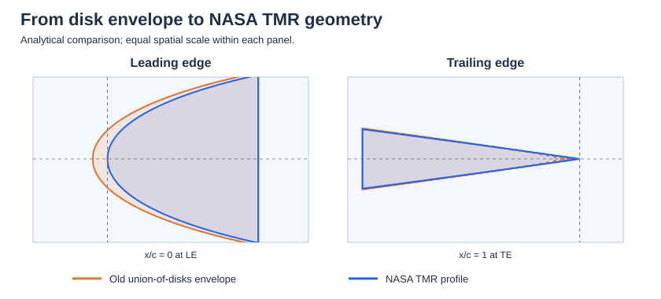
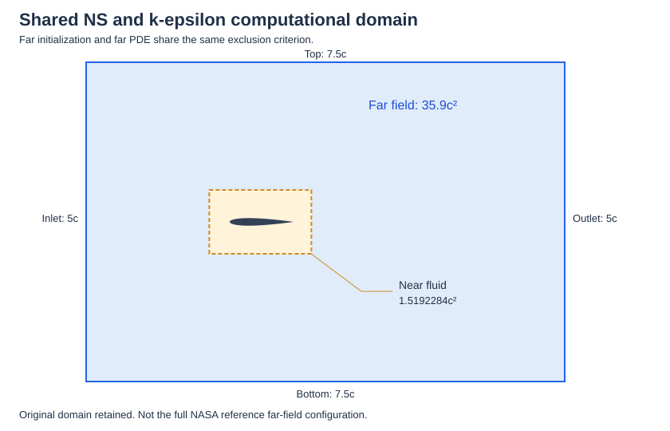
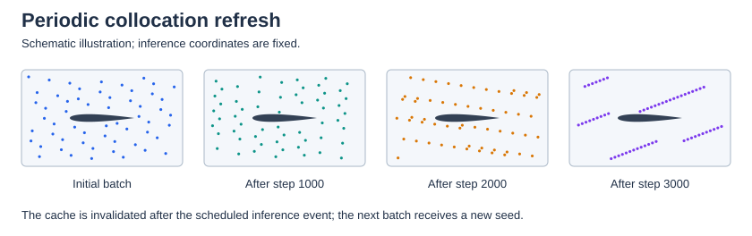

# k_e_noslip — thesis study baseline

Steady, two-dimensional incompressible standard k-epsilon RANS PINN with physical no-slip and a matched Navier-Stokes (NS) comparator. **No wall functions, wall offset or prescribed wall epsilon.** This is intentionally a high-Re no-slip baseline, not a validated low-Re near-wall closure.

## Reproduction

Both executables use the same Warp geometry, sampling settings, domain, Reynolds number and training budget. NS retains a single u,v,p network and sum loss. The k-epsilon model retains four decoupled networks and initialization aggregation.

Use a single-GPU NVIDIA PhysicsNeMo Sym environment compatible with the legacy constraint API (e.g. 25.08), NVIDIA Warp, PyTorch and NumPy. The original geometry and cache preflight passed on the reported CPU and RTX 4500 Ada (Warp 1.10.0). The k-epsilon smoke test reached step 1000 with a finite loss and the expected cache reset. The new archive launcher and augmented boundary inferencer still require the short integration smoke test below.

```bash
cd k_e_noslip
python -m compileall -q .
python preflight_geometry.py --device cpu
python preflight_geometry.py --device cuda:0
python airfoil_ke_corrected.py training.max_steps=1100 training.rec_constraint_freq=1000 network_dir=smoke_ke
python airfoil_ns.py training.max_steps=1100 training.rec_constraint_freq=1000 network_dir=smoke_ns
# Confirm the step-1000 refresh and inspect both VTP outputs.
python ../tools/archive_training.py --self-test
python ../tools/archive_training.py --interval 1000 -- airfoil_ke_corrected.py training.max_steps=1100 training.rec_constraint_freq=1000 network_dir=smoke_archive_ke
# Production training with step-indexed history:
python ../tools/archive_training.py -- airfoil_ke_corrected.py
python ../tools/archive_training.py -- airfoil_ns.py
```

Default Re=6,000,000, alpha=0, nominal thickness=0.12 and camber=0. Both configurations set max_steps=1,000,000. To compare at the original NS Reynolds number, pass custom.reynolds_number=1000000.0 to **both** executables. Start new checkpoint directories; do not reuse incompatible historical checkpoints. A checkpoint restart is not bitwise reproducible before the next scheduled sampling reset.

## Geometry, normals and integration

NASA TMR extends the original NACA section to its natural sharp trailing edge and scales it to unit chord. The published symmetric profile is

```text
y/c = +/- 0.594689181 * (0.298222773 sqrt(x/c)
      - 0.127125232 (x/c) - 0.357907906 (x/c)^2
      + 0.291984971 (x/c)^3 - 0.105174606 (x/c)^4)
```



The shared Warp module discretizes this formula with 501 cosine-spaced points per side, giving 1,000 unique polygon segments. Endpoints close exactly despite rounding of the published coefficients. The resulting numerical contour approximates the analytic TMR profile, not an exact continuous signed-distance solution.

The old union-of-disks SDF is replaced by the minimum distance to projected points on segments. The sign is determined by half-open ray crossing. With counterclockwise solid vertices, the boundary normal is the left normal, pointing into the solid (out of the fluid). Axis-aligned normals are valid. A zero-distance guard avoids division by zero, and positive fluid distance and unit normals/gradients are checked at sampling time.

The original near-field weighting convention is preserved: SDF is the minimum of airfoil distance and distances to near top/bottom, excluding the artificial x interfaces. Near PDE lambda remains 2*max(sdf,0). The polygon is sampled uniformly in arc length; interior points use conditional rejection. The Warp implementation supports continuous tuple ranges of alpha, camber and nominal thickness; generalized cambered/scaled sections are not themselves NASA validation geometries. All profiles must fit the near rectangle.



| Constraint | Total geometric measure (c=1) | Batch size |
|---|---:|---:|
| inlet | 5 | 640 |
| outlet | 5 | 640 |
| top_bot | 15 | 640 |
| airfoil | 2.0390975 | 512 |
| interior_near_field / interior_init | 1.5192284 | 7000 |
| interior_far_field / interior_init_far_field | 35.9 | 6000 |

These are independently calculated double-precision polygon measures, not measured Warp outputs. Solid area=0.080771642 and maximum thickness=0.11897122. The NASA TMR page describes the maximum thickness as approximately 0.11894c; evaluating its published coefficients on the 501-point cosine grid gives 0.1189712189c. The preflight now tests this polynomial-derived value directly, without changing the geometry. Each sample carries its conditional geometric measure divided by batch size. Area weights implement spatial quadrature and are distinct from PDE lambda weights. Top/bottom totals 2 × 7.5, not a tunable loss multiplier.

## Dynamic sampling



The solver follows the original ver4 post-inference cache invalidation strategy at steps 1000, 2000, etc. Every constraint has a separate cache and deterministic seed derived from its name and refresh index. Common constraint names use the same seed schedule in NS and k-epsilon. The next batch after the event is new; this is periodic random resampling, not residual-based adaptive sampling. CUDA graphs are disabled and num_workers=0. Only the nominal 0-degree inference group is active in this baseline (near_field_1, boundary_1, far_field_1). The six random inference groups remain commented out for future parametric runs. Inference points are generated before training and remain fixed.

## Step-indexed training history

The reusable [archive launcher](../tools/archive_training.py) preserves constraints and inferencers at step 0 and every 50,000 steps, while training continues. The legacy PhysicsNeMo Sym trainer normally overwrites its result files. The launcher hooks the actual constraint and inference recording events, captures only files written at the matching step, then writes immutable bytes with a background thread. A completed snapshot is published atomically with a manifest and the run configuration. There is no polling, second GPU process, or change to sampling/optimization. Recording frequencies remain 10,000 (constraints) and 1,000 (inference); both divide 50,000.

```bash
# From this model folder, start a fresh run with history.
python ../tools/archive_training.py -- airfoil_ke_corrected.py
# For an archive outside the repository, supply a unique path:
python ../tools/archive_training.py --archive-dir /path/to/history/ke_run -- airfoil_ke_corrected.py
# The same launcher works for other legacy PhysicsNeMo Sym training executables.
python ../tools/archive_training.py -- airfoil_ns.py
```

Default output location: the actual PhysicsNeMo network_dir/training_history, including Hydra's run path. Each step directory contains constraints/, inferencers/, config.yaml and manifest.json (sizes and SHA-256 hashes). A fresh run through step 1,000,000 produces 21 snapshots if every scheduled recording succeeds. Existing snapshots are retained on a same-run restart; do not reuse an archive directory across independent runs. If a final step is not a multiple of the interval, it is not archived automatically. Plain execution of the model file does not activate the launcher. This script assumes the legacy single-process Trainer recording API and native output directories; it fails on incompatible recording intervals or missing result files. It does not archive model or optimizer checkpoints.

### Surface data for drag analysis

The fixed boundary_1 inferencer now records p, u, v, the four first velocity derivatives (u__x, u__y, v__x, v__y), normal_x, normal_y and area, plus k and ep for k-epsilon. The derivatives are obtained by automatic differentiation (requires_grad=True) in inference only. The normals point out of the fluid, into the solid; area is the arc-length quadrature weight. These fields enable separate pressure and molecular-viscous traction integration, subject to the limitations of this baseline and the 512-point random arc-length quadrature. The fixed coordinates help compare training steps; accurate absolute drag still requires surface quadrature convergence. Wall-function models need their own shear-stress outputs and post-processing conventions; the archive launcher itself is model-agnostic. No drag coefficients are calculated automatically.

References: [Trainer recording implementation](https://docs.nvidia.com/physicsnemo/25.08/_modules/physicsnemo/sym/trainer.html), [PointwiseInferencer API](https://docs.nvidia.com/physicsnemo/25.08/physicsnemo-sym/api/physicsnemo.sym.domain.inferencer.html).
 
## Changes from the original repository

Sources: [original Ver1 NS](https://github.com/georgios-giannakos/PINNs/tree/main/models/Ver1/navier-stokes), [original Ver1 k-epsilon](https://github.com/georgios-giannakos/PINNs/tree/main/models/Ver1/k-epsilon), [ver4](https://github.com/georgios-giannakos/PINNs/tree/main/models/ver4). The k-epsilon PDE and executable build on the supplied corrected files. The changes below distinguish those inherited corrections from this release's geometry and sampling work.

| Component | Original Ver1 | This release | Reason |
|---|---|---|---|
| Profile | Closed TE using -0.1036 | NASA TMR scaled polynomial | Match published geometry |
| Backend | Warp | Warp | Retain GPU geometry and parameterization |
| SDF | Union of disks | Signed segment distance | Correct contour and sign |
| Resolution | 501 chordwise samples | 501 cosine-spaced points per side | Resolve LE and TE |
| Boundary points | Projection from random queries | Uniform polygon arc length | Consistent integration |
| Normals | Zero-component normals rejected; finite-difference normalization | Unit segment normals; guarded distance gradients | Correct orientation and numerical safety |
| Area | Channel boundary/interior measures reused | Actual perimeter, fluid area and exact far area | Correct quadrature |
| Far init | Absent in original; unfiltered in corrected upload | Common far_criteria | Exclude near region and solid |
| Far inference | Full rectangle in original NS | Common far_criteria | Match training region |
| Sampling | Fixed dataset | Online cached batches, 1000-step refresh | Reuse ver4 cadence |
| RANS stress (inherited correction) | Scalar diffusion approximation | Symmetric stress divergence and 2/3 grad(k) | Mean static pressure formulation |
| Turbulence viscosity (inherited) | Large denominator guard | 1e-20 guard | Preserve freestream viscosity ratio |
| Turbulence outputs (inherited) | Clipped symbolic softplus, floor 1e-4 | Stable scaled PyTorch softplus, floor 1e-12 | Represent small freestream values |
| Initialization (inherited) | Separate target prescription | Same targets as inlet, normalized residuals | Consistency and scaling |
| PDE scales (inherited) | Unscaled k/epsilon residuals | Fixed k_ref=1e-3, ep_ref=1e-2 | Retain corrected model |
| k-epsilon aggregator | Tanh transition | Unchanged | Preserve initialization schedule |
| Reynolds | 1e6 | 6e6 for both, configurable | Match NASA Re and compare models |
| Training budget | NS 200k; k-epsilon 400k | 1M for both | Thesis study budget |
| NS numerical settings | Original NS defaults | Matched 512-wide 6-layer SiLU settings, Adam 1e-4, decay 0.95/8000 and common batches | Reduce numerical confounders |
| Network structure | NS single network; k-epsilon four | Retained | Preserve model definitions |
| Domain and BCs | Original rectangle and no-slip | Retained | Baseline comparability |
| Near PDE lambda | 2*max(sdf,0) | Retained | Preserve weighting convention |
| Checkpoints | Historical paths | Separate NS and k-epsilon paths | Avoid cross-model overwrite |
| Inference groups | Seven groups, redundant at fixed parameters | One active group, six commented | Fixed 0-degree study |
| Boundary inference | Field predictions only | Normals, area and first velocity derivatives added | Enable traction post-processing |
| Training history | Native files overwritten | Exact-step archives via optional shared launcher | Preserve thesis field evolution |

## Constraint inventory

| Constraint | NS | k-epsilon |
|---|---|---|
| inlet | u=1, v=0 | u=1, v=0, k_inf, ep_inf |
| outlet | p=0 | p=0 |
| top_bot | u=1, v=0 | u=1, v=0, k_inf, ep_inf |
| airfoil | u=0, v=0 | u=0, v=0, k=0 (positive-floor approximation) |
| interior_init | — | Five initialization residuals |
| interior_init_far_field | — | Five initialization residuals in far region |
| interior_far_field | continuity, momentum_x, momentum_y | Same plus k_equation, ep_equation |
| interior_near_field | Same three PDEs with SDF weighting | Same five PDEs with SDF weighting |

At Re=6e6, U=c=rho=1, I=0.001 and nu_t/nu=10, nu=1/6e6, k_inf=1.5e-6, ep_inf=1.215e-7. The k-epsilon transition remains centered at 20,000 steps. NS is a steady no-closure comparator, not DNS of turbulence.

## Verification status and limitations

- Reported server verification (Warp 1.10.0, CUDA 12.8, RTX 4500 Ada): full geometry and cache preflight PASS on CPU and CUDA; k-epsilon training reached step 1000, loss 0.002610, and logged the scheduled cache reset. The log does not independently establish that step-1001 coordinates changed or that the 1100-step run finished. NS smoke test and the new archive launcher/boundary-output integration remain to be confirmed.
- A million-step configuration is not proof of convergence or successful completion. Record software versions, seed, commit hash and actual final step.
- The original finite domain is much smaller than the NASA reference domain. The incompressible PDE formulation also differs from the low-Mach compressible reference. Geometry matching is not full benchmark reproduction.
- Standard high-Re k-epsilon without wall treatment is not a physically complete near-wall closure. Treat Cf and drag predictions as baseline results, not verified wall-resolved RANS.
- Before thesis conclusions, check residual convergence, mass conservation, symmetry, domain independence and geometry resolution sensitivity; compare Cp, Cf, total CD and separate viscous/pressure components to reference data.

## References

1. [NASA TMR: NACA 0012 validation case](https://tmbwg.github.io/turbmodels/naca0012_val.html).
2. [NASA TMR: NACA 0012 numerical analysis and grid convergence](https://tmbwg.github.io/turbmodels/naca0012numerics_val.html).
3. Launder and Spalding (1974), *The numerical computation of turbulent flows*, CMAME 3(2), 269–289. [DOI](https://doi.org/10.1016/0045-7825%2874%2990029-2).
4. [NVIDIA PhysicsNeMo Sym constraint API](https://docs.nvidia.com/physicsnemo/25.08/physicsnemo-sym/api/physicsnemo.sym.domain.constraint.html).
5. [NVIDIA Warp documentation](https://nvidia.github.io/warp/).
6. [Original PINNs project](https://github.com/georgios-giannakos/PINNs).

Applicable NVIDIA Apache-2.0 source notices are retained. New modules use Apache-2.0 SPDX identifiers.
