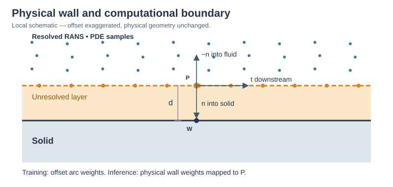
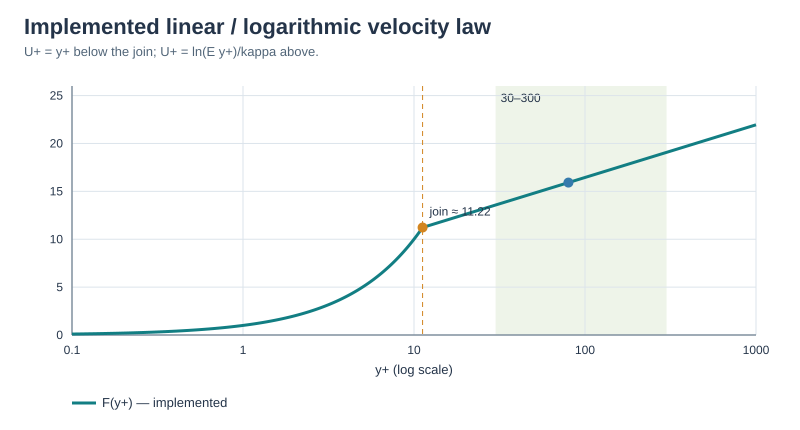
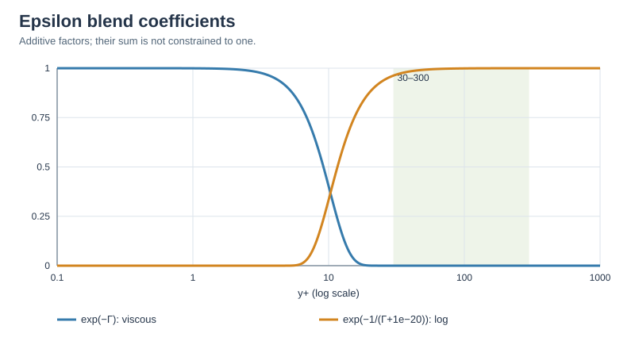
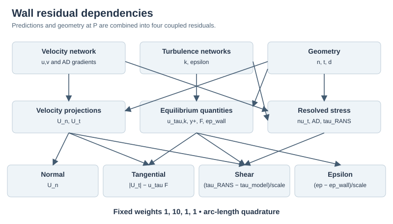
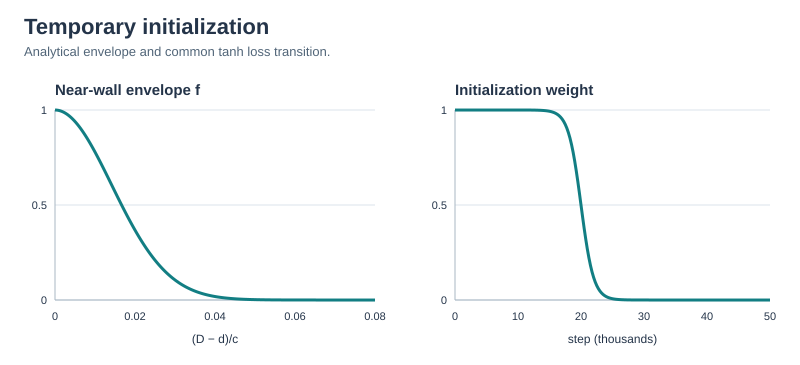

# k_e_wf — thesis wall-function comparator

Steady 2-D incompressible standard high-Re k-epsilon RANS PINN with corrected equilibrium Launder–Spalding wall treatment. Built from [k_e_noslip](../k_e_noslip/) at a40d7e1aefa28fec04a848884e6b09a238003b4f. The [standalone NS baseline](../N-S_noslip_corrected/) is unchanged. **Research candidate, not a validated solution.**

## Reproduction

Same single-GPU legacy PhysicsNeMo Sym environment (e.g. 25.08), Warp, PyTorch, NumPy and VTK as the baselines. Use a fresh checkpoint; no historical checkpoint is compatible.

```bash
cd k_e_wf
python -m compileall -q .
python preflight_geometry.py --device cpu
python preflight_wf.py --device cpu
python preflight_geometry.py --device cuda:0
python preflight_wf.py --device cuda:0
python airfoil_ke_wf.py training.max_steps=1100 training.rec_constraint_freq=1000 network_dir=smoke_wf
python ../tools/archive_training.py --self-test
python ../tools/archive_training.py --interval 1000 -- airfoil_ke_wf.py training.max_steps=1100 training.rec_constraint_freq=1000 network_dir=smoke_archive_wf
# Pilot: allow the initialization transition to finish
python ../tools/archive_training.py -- airfoil_ke_wf.py training.max_steps=50000 network_dir=pilot_wf
# Production only after acceptable pilot diagnostics
python ../tools/archive_training.py -- airfoil_ke_wf.py
# Alternative historical Reynolds number (fresh checkpoint)
python ../tools/archive_training.py -- airfoil_ke_wf.py custom.reynolds_number=1000000.0 network_dir=network_checkpoint_ke_wf_re1m
```

Smoke tests verify plumbing, not convergence. The common initialization schedule is centered at step 20,000. Check the step-0/1000 archives, new constraint coordinates after refresh, finite losses, VTP fields and monitor CSVs. To continue the same pilot rather than start a fresh production run, retain the pilot directory and all settings except max_steps; verify its optimizer checkpoint step. The shared archive launcher saves snapshots every 50k including step 0, not optimizer/model weights.

## Shared numerical framework

The [main README](../README.md) defines the comparison to NVIDIA and Ver1, common geometry, numerical settings, sampling, quadrature and recording. At Re=6e6, nu=1/6e6, k_inf=1.5e-6 and ep_inf=1.215e-7 (I=0.001, viscosity ratio 10). The RANS PDE, original geometry, cache, solver and aggregator are copied unchanged. The four networks, domain, outer BCs, optimizer, batches and training budget match the no-slip RANS baseline. WF differs in the computational wall, near initialization, positive mapping, wall residuals and diagnostics. Near and wall coordinates necessarily differ due to the unresolved layer.

## Offset geometry

Underlying physical polygon: same NASA TMR 501 cosine points per side, 1,000 segments, signed segment SDF and normals into solid. The fixed nominal convex polygon is offset to P=W-d*n, d/c=target_yplus/(Re*utau_ref) = 0.000333333 at Re=6e6 (80, 0.04), 0.002 at Re=1e6. This is a selection heuristic, not a prescribed k or y+ constraint. No y+ penalties and no adaptive weighting.

Wall training samples offset segments and round vertex arcs with offset-perimeter weights. Interior rejects true wall distance <=d (not strips at top/bottom), with resolved measure 1.5192284 - perimeter*d - pi*d^2 by the convex parallel-body formula, subject to float32 polygon tolerance. Far area remains 35.9. The original SDF remains the PDE weight. The boundary inferencer retains the physical-wall arc-length samples/weights mapped to P; actual distance is checked. Only the fixed nominal profile is supported in this WF benchmark; general nonconvex/cambered offsets require new verification. Normal at P is an approximate impermeability condition, not exact boundary-layer mass conservation.

## Wall conditions

At P: U_t=U dot t, u_tau=C_mu^0.25 sqrt(k), y+=u_tau*d/nu. t points downstream, n from fluid into solid. U+=y+ below the continuous linear/log join at 11.224708076; above, U+=log(E*y+)/kappa with E=9.793 and kappa=0.4187. Epsilon uses u_tau^3/(kappa*d) with an exponential blend to 2*nu*k/d^2 at low y+. These safeguards do NOT make standard high-Re k-epsilon a validated low-Re closure.

| Residual at P | Fixed lambda |
|---|---:|
| U dot n = 0 | 1 |
| abs(U_t)-u_tau*U+(y+) = 0 | 10 |
| (tau_RANS-tau_model)/utau_ref^2 = 0 | 1 |
| (ep-ep_wall)/(utau_ref^3/(kappa*d_ref)) = 0 | 1 |

tau_model = nu*U_t/d * y+/U+ (ratio exactly 1 on linear branch). tau_RANS = t dot [(nu+nu_t)(grad U + grad U^T)] dot (-n). Both are signed kinematic traction on solid. The tangential velocity wall law closes equilibrium k jointly with velocity; stress closes tangential momentum. No additional k-gradient or independent velocity Dirichlet condition is imposed. When the equilibrium residual vanishes, abs(tau_model)=u_tau^2. No physical-wall no-slip or k=0. Relative tangential emphasis is inspired by 22D, not raw copied weights: residual scales differ. Fixed weights are pilot choices, not tuned or validated.

Unlike the inlet-scaled positive mapping in the baseline, shifted stable softplus uses k_scale=1e-3, ep_scale=1e-2, with raw zero still equal to inlet values and floor 1e-12. This allows realistic wall magnitudes without excessively large raw outputs. Initialization aggregator and far initialization are unchanged; near initialization seeds equilibrium-scale k/epsilon and approximately projected tangential velocity, decaying over 0.02c. This is a warm-start heuristic only, not data supervision or a persistent constraint. These two explicit WF-specific numerical changes target the collapse seen in the historical V4; their effectiveness is unverified.

## Detailed wall-treatment methodology

### 1. Geometry and the unresolved layer



The physical surface W is unchanged. The computational boundary is P = W − d n, with n pointing from the fluid into the solid. The outward-solid normal is −n; t is an orthogonal downstream tangent. The local equilibrium wall treatment replaces the unresolved layer, rather than prescribing a nonzero speed at the physical no-slip surface.

The geometry wrapper translates each polygon segment along its outward-solid normal and closes adjacent translated segments with circular arcs. The offset curve is sampled uniformly in its own arc length. Near-field PDE sampling excludes points with actual distance to the solid D ≤ d. The original near-field SDF (which also includes the horizontal rectangle boundaries) remains the PDE weighting function. The wider auxiliary distance-query rectangle separates true wall distance from those artificial boundaries.

For a convex polygon of area A_s and perimeter L_s, the parallel-body formula gives

$
A_{\mathrm{resolved}}=A_{\mathrm{rectangle}}-A_s-L_s d-\pi d^2,\qquad L_{\mathrm{offset}}\simeq L_s+2\pi d.
$

The actual training perimeter is the sum of offset segment lengths and nonnegative vertex-turn arc lengths. The formula is subject to float32 polygon roundoff. Training boundary quadrature uses the offset perimeter; boundary inference uses the original physical perimeter and maps its samples to P.

### 2. Wall distance and local dimensionless variables

With U_inf=c=rho=1, nu=1/Re. The reference y+ and friction velocity select a constant distance, not a prescribed solution:

$
d/c=\frac{y^+_{\mathrm{ref}}}{Re\,(u_{\tau,\mathrm{ref}}/U_\infty)}.
$

| Re | Reference y+ | Reference u_tau/U_inf | d/c |
|---:|---:|---:|---:|
| 6,000,000 | 80 | 0.04 | 0.000333333 |
| 1,000,000 | 80 | 0.04 | 0.002 |

At P, the actual quantities depend on the network prediction:

$
U_t=\mathbf U(P)\cdot\mathbf t,\quad U_n=\mathbf U(P)\cdot\mathbf n,\quad
u_{\tau,k}=C_\mu^{1/4}\sqrt{k(P)},\quad y^+=u_{\tau,k}d/\nu.
$

C_mu=0.09. The k-based friction velocity follows the local-equilibrium hypothesis; the independently reported shear-based value is sqrt(abs(tau_model)). They coincide when the equilibrium residual is satisfied. The commonly monitored 30–300 interval is not a constraint; stagnation, separation and low local shear can lead to values outside it.

### 3. Tangential equilibrium wall law



The implemented linear/log Launder–Spalding approximation is

$
F(y^+)=\begin{cases}
y^+,&y^+\le y_j^+\\
\ln(Ey^+)/\kappa,&y^+>y_j^+.
\end{cases}
$

Here kappa=0.4187, E=9.793 and the code uses y_j+=11.224708076046031. This is the high intersection of the linear and logarithmic branches (continuous to numerical precision, not differentiable at the join). The unused logarithmic branch is clamped to avoid invalid evaluations in torch.where.

The residual is

$
r_t=|U_t|-u_{\tau,k}F(y^+).
$

It couples k and tangential speed instead of imposing an independent fixed velocity at P. Absolute speed permits reversed flow, while the separate signed traction retains its direction. This does not imply that the equilibrium wall law accurately models separation.

### 4. Signed shear and automatic differentiation

The modeled kinematic traction on the solid is

$
\tau_{\mathrm{model}}=\frac{\nu U_t}{d}\frac{y^+}{F(y^+)}.
$

The ratio is exactly one in the linear branch. Substituting the equilibrium relation gives tau_model=sign(U_t) u_tau,k². The independent stress predicted by the resolved RANS field uses the full symmetric velocity gradient:

$
\nu_t=\frac{C_\mu k^2}{\varepsilon+10^{-20}},\quad
\tau_{\mathrm{RANS}}=-\mathbf t\cdot[(\nu+\nu_t)(\nabla\mathbf U+\nabla\mathbf U^\mathsf T)]\mathbf n.
$

In components, exactly as implemented:

$
\tau_{\mathrm{RANS}}=-(\nu+\nu_t)\{t_x[2u_xn_x+(u_y+v_x)n_y]+t_y[(u_y+v_x)n_x+2v_yn_y]\}.
$

PhysicsNeMo obtains the four first derivatives using automatic differentiation of the velocity network. The minus sign converts the fluid-outward normal into the solid-outward normal. Isotropic pressure and isotropic Reynolds stress cancel in the tangential projection. The residual compares the modeled traction with the full effective stress at P, rather than using molecular viscosity alone or assuming a positive shear direction.

### 5. Epsilon closure

The log-layer equilibrium relation and viscous safeguard are

$
\varepsilon_{\log}=\frac{C_\mu^{3/4}k^{3/2}}{\kappa d}
=\frac{u_{\tau,k}^3}{\kappa d},\qquad
\varepsilon_{\mathrm{visc}}=\frac{2\nu k}{d^2}.
$

The implementation uses the following exponential blend inspired by OpenFOAM:

$
\widehat y^+=\operatorname{clamp}(y^+,0,10^4),\qquad
\Gamma=\frac{0.001(\widehat y^+)^4}{1+\widehat y^+}
$

$
\varepsilon_{\mathrm{wall}}=\varepsilon_{\mathrm{visc}}e^{-\Gamma}
+\varepsilon_{\log}e^{-1/(\Gamma+10^{-20})}.
$



These are additive factors, not a convex interpolation whose weights necessarily sum to one. The cap applies only to the blend argument, not to y+ monitoring or a loss penalty. The low-y+ branch is a numerical closure safeguard; it does not turn standard high-Re k–epsilon into a validated low-Re model.

### 6. Coupled wall constraints and loss



| Residual | Formula | Fixed lambda |
|---|---|---:|
| Normal | U_n | 1 |
| Tangential equilibrium | abs(U_t) − u_tau,k F(y+) | 10 |
| Shear | (tau_RANS − tau_model)/u_tau,ref² | 1 |
| Dissipation | (ep − ep_wall)/(u_tau,ref³/(kappa d_ref)) | 1 |

At the default case the shear normalization is 0.0016 and the epsilon normalization is approximately 0.45856. The velocity residuals already use the nondimensional U_inf=1 convention. The wall objective uses the sampled arc-length weights and fixed lambda multipliers, before the common initialization/physics aggregation. There is no additional k-normal-gradient condition or physical no-slip condition inside the removed layer. Pressure is not prescribed at P.

This is a coupled modeling choice, not a proof of well-posedness or uniqueness. Small k and small tangential speed can still coexist; satisfying wall residuals alone cannot rule out an incorrect flow solution. The fixed weights are initial pilot choices and are not raw copies of historical 22D weights, which used different residual scaling.

### 7. Positive field mapping and near-wall initialization

The no-slip baseline uses an inlet-scaled softplus. The WF mapping retains its inlet value at zero raw output while using wall-scale amplitudes:

$
q=q_{\min}+s_q\,\operatorname{softplus}(z_q+b_q),\qquad
b_q=\ln\left[\operatorname{expm1}\left(\frac{q_\infty-q_{\min}}{s_q}\right)\right].
$

For q=k or epsilon, the floor is 1e-12, s_k=1e-3 and s_ep=1e-2. This enables realistic wall magnitudes without requiring excessively large raw outputs. It does not impose a fixed wall turbulence value.

Let D be the true physical wall distance (D≥d), and n_D its SDF gradient pointing into the fluid. The temporary initialization envelope is

$
f(D)=\exp[-((D-d)/w)^2],\qquad w=0.02c.
$

The local seed friction velocity is u_tau,ref abs(n_D,y). The seed k_w is the maximum of its squared value divided by sqrt(C_mu) and k_inf; ep_w is the maximum of the wall epsilon evaluated from k_w at d and ep_inf.

$
k_0=k_\infty+f(k_w-k_\infty),\qquad
\varepsilon_0=\varepsilon_\infty+f(\varepsilon_w-\varepsilon_\infty)d/D.
$

With a=min(1,u_tau,ref F(y_ref+)), the velocity seed is u_0=(1−f)+fa(1−n_D,x²), v_0=−fa n_D,x n_D,y and p_0=0. This is a projected near-wall warm start, not a resolved boundary-layer solution or CFD supervision. The near initialization residuals are u−u_0, v−v_0, p, (k−k_0)/k_0 and (ep−ep_0)/ep_0. Far initialization is identical to the no-slip baseline.

The common tanh aggregator transitions from initialization to physics:

$
w_{\mathrm{init}}(s)=\tfrac12[1+\tanh(0.0005(20000-s))],\quad
L=w_{\mathrm{init}}L_{\mathrm{init}}+(1-w_{\mathrm{init}})L_{\mathrm{physics}}.
$



The seed is temporary, not a persistent condition or adaptive loss. These changes address the early turbulence collapse observed in historical V4 (2,000 steps); effectiveness is unverified, and the historical checkpoint does not isolate a single cause.

### 8. Force reconstruction

At inference, W is a physical-wall quadrature point and P is its mapped evaluation point. Approximate p(W) by p(P), and use the modeled wall traction rather than a molecular gradient at W. With the nondimensional reference values:

$
C_p=2[p(P)-p_\infty],\qquad C_f=2\tau_{\mathrm{model}}.
$

$
C_{D,p}=\frac{1}{c}\int_W C_p n_x\,ds,\qquad
C_{D,f}=\frac{1}{c}\int_W C_f t_x\,ds,\qquad C_D=C_{D,p}+C_{D,f}.
$

Lift uses n_y and t_y. The postprocessor implements physical arc-length quadrature, not offset perimeter integration. Pressure at P, equilibrium traction and random quadrature introduce uncertainty. Check pressure reference, normal closure, offset sensitivity and quadrature convergence before interpreting absolute drag.

### 9. Pilot acceptance checks

- Geometry: true offset distance, orthogonal unit normals/tangents, no PDE points in the excluded layer, physical and offset measures, deterministic cache renewal.
- Manufactured wall cases: both signed directions, linear/log branches and finite residual gradients. These establish algebraic checks, not flow validation.
- Smoke test: graph unrolling, finite losses, VTP variables, monitors and archived outputs. The 1,100-step smoke precedes the physics transition.
- Pilot through 50k: check inlet, mass conservation, physical stagnation/suction and pressure recovery, velocity acceleration and wake, symmetry, near-zero lift and nontrivial drag.
- Inspect k, epsilon, y+ distribution, k-derived versus shear-derived friction velocity, signed Cf and individual PDE/BC residuals. Low total loss is not evidence of physical convergence.
- Compare Cp, Cf, pressure/friction CD and CL to matched models and NASA reference data. Test domain, offset and quadrature sensitivity.

All diagrams here are schematics or analytical evaluations of the implementation, not trained PINN results.

## Constraints

| Name | Outputs |
|---|---|
| inlet, top_bot | u,v,k,ep |
| outlet | p |
| airfoil | velocity_wall_normal_wf, velocity_wall_parallel_wf, wall_shear_stress_wf, ep_wf |
| interior_init | u_near_init,v_near_init,p_near_init,k_near_init,ep_near_init |
| interior_init_far_field | u_init,v_init,p_init,k_init,ep_init |
| interior_near_field, interior_far_field | continuity,momentum_x,momentum_y,k_equation,ep_equation |

Same far criterion for training/inference, same independent named caches for all constraints. No PDE sampling inside excluded strip.

## Inference, monitors and force integration

Same three inferencer names: near_field_1, boundary_1, far_field_1. Near/far record u,v,p,k,ep; near also wall_distance. Boundary VTP coordinates x,y are **P**, not W; physical x_wall,y_wall, physical area weights, normals, downstream tangents and normal_distance are retained. Fields include u,v,p,k,ep and four AD velocity derivatives, signed wall_tau_model and wall_tau_rans, u_tau (from k), u_tau_shear, y_plus_wall, u_plus_wall, cf_wall, nu_t_wall, ep_wall_target, four residuals. Wall monitors report y+ range/fractions, k,ep,u_tau, signed Cf, reverse-flow fraction and RMS residuals every 1k; they do not change the loss.

```bash
python surface_coefficients.py /path/to/snapshot/inferencers --output surface_50k.csv
```

Use the actual archive directory. The script estimates p_inf from upstream far points (x<-1.5) or accepts --p-inf. Cp=2*(p(P)-p_inf), Cf=2*tau_model; integrates Cp*n + Cf*t on **physical** contour quadrature, not offset weights, to report separate CD and CL pressure/shear contributions. Reports normal closure errors. Pressure at P approximates wall pressure. Converge surface quadrature before citing absolute drag; 512 randomly sampled points are diagnostic. The postprocessor is WF-specific.

## Verification and limitations

- New Warp and PhysicsNeMo runtime tests are **pending** in the target environment. No validated or trained WF results are claimed. The shared baseline preflight does not certify the new wrapper or graph.
- Before 1M production, pass CPU/CUDA preflight and 1100-step smoke (including archive integration); inspect the 50k pilot after the 20k transition. Check inlet, individual PDE/BC residuals, k/ep and y+, pressure peak/recovery, velocity/wake, symmetry, Cp/Cf/CD/CL. Low total loss is insufficient.
- Local-equilibrium wall treatment, stagnation, sharp TE, curvature, pressure gradients and separation limit accuracy. Standard high-Re k-epsilon remains invalid as a low-Re closure; linear/blended safeguards only avoid singularity. Domain smaller than NASA and incompressible rather than low-Mach compressible. NASA SA and k-epsilon variants are context, not exact equivalence.
- Record commit, software versions, seed, actual steps, and pressure reference. No adaptive weighting, historical checkpoint, y+ penalty or trained results included.

## Sources

- [Launder & Spalding (1974)](https://doi.org/10.1016/0045-7825%2874%2990029-2).
- [OpenFOAM epsilonWallFunction](https://doc.openfoam.com/2312/tools/processing/boundary-conditions/rtm/derived/wall/epsilonWallFunction/) (exponential blend).
- [NASA TMR NACA 0012 validation](https://tmbwg.github.io/turbmodels/naca0012_val.html) and [grid convergence](https://tmbwg.github.io/turbmodels/naca0012numerics_val.html).
- [PhysicsNeMo Sym 25.08 monitors](https://docs.nvidia.com/physicsnemo/25.08/physicsnemo-sym/api/physicsnemo.sym.domain.monitor.html) and [inferencers](https://docs.nvidia.com/physicsnemo/25.08/physicsnemo-sym/api/physicsnemo.sym.domain.inferencer.html).
- [Baseline README](../k_e_noslip/README.md). Historical 22D and V4 motivated the design, not validation.

Applicable NVIDIA Apache-2.0 notices retained; new modules use Apache-2.0 SPDX identifiers.
